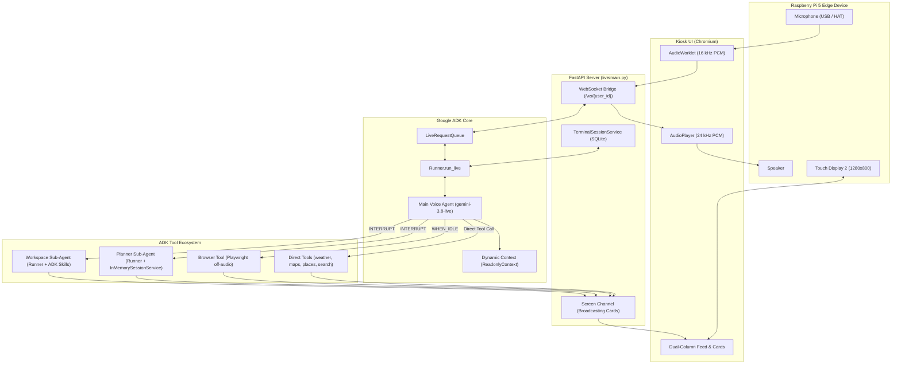

# ADK Live AI Concierge

Multi-agent development: see [the framework setup guide](docs/agent-framework.md).

A reference implementation and hardware showcase of **Google ADK (`google-adk>=2.8.0`)** and the **Gemini Multimodal Live API**, built on a Raspberry Pi 5 with a Raspberry Pi Touch Display 2 (10") and dedicated audio hardware.

This project demonstrates how to build an edge conversational appliance using the full breadth of Google ADK capabilities:
- **Full-Duplex Multimodal Live Streaming**: Bidirectional voice streaming using `Runner.run_live`, `LiveRequestQueue`, and native 16 kHz/24 kHz PCM over WebSockets.
- **Dynamic Context Injection**: Runtime turn instruction callbacks via `ReadonlyContext` (clock, geocoded physical coordinates, language preferences) and error interception via `on_tool_error_callback`.
- **Non-Blocking Asynchronous Tools**: Decoupled tool scheduling (`FunctionResponseScheduling.WHEN_IDLE` and `INTERRUPT`) so web browsing and Workspace sub-agents execute off the conversational audio path without blocking spoken interaction.
- **Hierarchical Multi-Agent Systems**: Autonomous sub-agents (`build_plan_agent`, `build_gws_agent`) running dedicated ADK `Runner` instances and `InMemorySessionService`.
- **Modular ADK Skills**: Progressive on-demand skill discovery via `google.adk.skills.load_skill_from_dir` and `SkillToolset`.
- **Stateful Session Persistence**: Custom `TerminalSessionService` subclassing `SqliteSessionService` for durable turn history, sliding token compression, and seamless reconnect replay.

## Architecture



## ADK Feature Implementation Guide

| ADK Capability | Implementation Pattern | Key Implementation Files |
|---|---|---|
| **Multimodal Live Streaming** | `Runner.run_live` + `LiveRequestQueue` with `StreamingMode.BIDI` and `AUDIO` modality | [`live/main.py`](src/ai_terminal/live/main.py) |
| **Realtime Barge-In & Compression** | `START_OF_ACTIVITY_INTERRUPTS` and `ContextWindowCompressionConfig` (16k -> 8k tokens) | [`live/main.py`](src/ai_terminal/live/main.py) |
| **Dynamic Instruction Callback** | Turn-by-turn system instruction injection via `ReadonlyContext` (clock, reverse-geocoded location, language) | [`live/agent.py`](src/ai_terminal/live/agent.py) |
| **Tool Error Recovery** | Intercepting schema / hallucination faults using `on_tool_error_callback` | [`live/agent.py`](src/ai_terminal/live/agent.py) |
| **Off-Audio Asynchronous Tools** | Background tool execution using `FunctionResponseScheduling.WHEN_IDLE` and `INTERRUPT` | [`live/tools/browse.py`](src/ai_terminal/live/tools/browse.py), [`live/tools/gws.py`](src/ai_terminal/live/tools/gws.py) |
| **Hierarchical Sub-Agents** | Multi-agent delegation using dedicated `Runner` and `InMemorySessionService` | [`live/tools/plan.py`](src/ai_terminal/live/tools/plan.py), [`live/tools/gws.py`](src/ai_terminal/live/tools/gws.py) |
| **Modular ADK Skills** | Progressive `SKILL.md` loading via `load_skill_from_dir` and `SkillToolset` | [`live/tools/gws.py`](src/ai_terminal/live/tools/gws.py), [`live/skills/`](src/ai_terminal/live/skills/) |
| **Durable Session Persistence** | Custom `TerminalSessionService` subclassing `SqliteSessionService` with replay neutralization | [`live/main.py`](src/ai_terminal/live/main.py) |
| **Custom Function Tools** | Python functions wrapped as `FunctionTool` with schema generation and `ToolContext` | [`live/tools/`](src/ai_terminal/live/tools/) |

## Live Voice Agent

`src/ai_terminal/live/` is a FastAPI server that bridges a browser to the ADK
Live API. Audio goes up as 16 kHz PCM over a WebSocket and comes back as
24 kHz PCM; every ADK event is forwarded as JSON so the page can draw the
model's transcript and its tool results side by side. The frontend it serves is
laid out for the Touch Display 2 in landscape — 1280x800 CSS px at dpr 1.5,
[measured on the panel](#what-the-panel-actually-gives-the-browser). Above
720 px wide the conversation and the cards get a column each; below it, on a
phone or a rotated panel, the cards go inline in the feed and the page reads
top to bottom.

```bash
git config core.hooksPath .githooks     # track issue #302 guards in .githooks
cd adk-live-ai-concierge                # repository root
cp .env.example .env                    # then fill in the keys below
uv sync
uv run live-server                      # add --reload while editing
```

Then open `http://localhost:8000/`. Talk by tapping the mic, or type — a typed
question still gets a spoken answer.

To deploy or try the demo server on Google Cloud Run without physical
hardware, see [deploy/CLOUD_RUN.md](deploy/CLOUD_RUN.md).

### Configuration

`2026-0906-raspi-ai-terminal/.env`, beside `pyproject.toml`. That directory and
not the one above it: `main.py:25` reads the file from there, and
`.gitignore:7` is what keeps it out of commits. The workspace root is a
different directory with no such line, so a `.env` left up there is both unread
and committable — which is why the `cp` above is the way to make one.

| Key | |
|---|---|
| `GOOGLE_GENAI_USE_VERTEXAI` | `TRUE` to use Vertex AI |
| `GOOGLE_CLOUD_PROJECT`, `GOOGLE_CLOUD_LOCATION` | Vertex AI project and region |
| `GOOGLE_CLOUD_PROJECT_NUMBER` | the Search grounding endpoint is project-number scoped |
| `GOOGLE_MAPS_API_KEY` | served to the browser for Maps JS |
| `HOME_LOCATION` | fallback address for a terminal whose location is not set |
| `HOME_COORDS` | the same place as `lat,lng`, for the clock's weather, which runs with no browser to ask; unset, `HOME_LOCATION` is geocoded once per process |
| `SCREENSAVER_DIR` | where the clock's background picture is kept, defaults to `screensaver` |
| `SCREENSAVER_MODEL` | which model draws that picture, defaults to `gemini-3-pro-image` — see [The clock's background](#the-clocks-background) |
| `SCREENSAVER_SEASON_DAYS` | how many days of weather that picture is drawn from, defaults to `7`; anything empty, unparseable or outside 1-92 falls back to it. Asked for on the first refresh of each local day and reused until the next, so the window costs one request a day rather than 48 |
| `LIVE_MODEL` | defaults to `gemini-3.8-live` |
| `LIVE_VOICE` | which voice a terminal nobody has asked answers in — see [Voice](#voice) |
| `GROUNDING_MODEL` | sidecar grounding model, defaults to `gemini-3.5-flash-lite` |
| `GWS_MODEL`, `GWS_LOCATION` | Workspace sub-agent, defaults to `gemini-3.8-flash` on `global` |
| `GWS_BIN` | path to the `gws` binary; found on `PATH` when unset |
| `GWS_CACHE_DIR` | where exported documents are kept, defaults to `gws_cache` |
| `GWS_CACHE_MAX_FILES`, `GWS_CACHE_MAX_BYTES` | what the cache is allowed to hold before the oldest go, defaults to 200 files and 64 MB |
| `SESSIONS_DB`, `SESSION_IDLE_GAP_S`, `SESSION_RETAIN_S`, `PROFILES`, `RECAP_BUDGET_S`, `RECAP_INPUT_CHARS` | conversation history — see [Conversation history](#conversation-history) |
| `BROWSE_MODEL` | picks each browser step, defaults to `gemini-3.8-flash` on `global` |
| `BROWSE_MAX_STEPS`, `BROWSE_BUDGET_S`, `BROWSE_ALLOWLIST`, `BROWSE_CHROMIUM` | the rest of the browser tool — see [The browser tool](#the-browser-tool) |
| `ALLOWED_HOSTS` | names this server answers to besides `localhost` and `127.0.0.1`, which is what both topologies use; anything else is refused with a 400 before it reaches a route |

`LIVE_MODEL` switches response modality on its own: a name containing
`native-audio`, ending in `-live`, or Gemini 3.x live runs in AUDIO mode with
input and output transcription, anything else in TEXT mode.

### Settings

The settings sheet is saved to `localStorage` under `ai-terminal.settings`, one
object for the lot, written on every change rather than when the sheet closes.
Unreadable JSON is treated as no settings at all — this thing boots itself on a
kitchen counter, and a half-written key is not worth a blank screen.

The microphone is the setting that matters, because the browser follows
PipeWire's default source and that is not always the one this terminal is meant
to be on — *Both processes can hold the microphone* below names that source and
says why. It is stored as `deviceId` plus label: Chrome scopes the id to
the origin and rotates it whenever the mic permission is reset, so the label is
what survives that, and the restore tries the id first and the label second.
Neither is visible until the permission is granted — before that
`enumerateDevices()` returns placeholder ids and empty labels — so on a first
run the choice is restored on the pass that follows the prompt, and the recorder
is restarted if it was already listening on the wrong device.

### Voice

The terminal answers in one of five prebuilt Live API voices, picked in the
settings sheet: **Kore**, Puck, Charon, Aoede, Fenrir. Kore is the default and
`LIVE_VOICE` in `.env` moves it.

Two things about this are not obvious.

**The list is served, not written into the page.** `main.py` keeps `VOICES` and
refuses a `voice` on the handshake that is not in it, falling back to the
default. It has to: google-genai types `PrebuiltVoiceConfig.voice_name` as a
bare string with no validation, so a name that is not a voice is not caught
until the Live API refuses the setup message — which on a kiosk is a socket
that comes up and goes down forever, with nothing on screen saying why. A copy
of the list in `index.html` would be free to drift from the one doing the
refusing, so `/api/config` carries both the list and the default and the select
is filled from them. A choice saved before the list changed snaps back to the
served default rather than sitting in the select as a name the socket ignores.

**Changing it reopens the socket.** The voice is part of the Live API's setup
message and there is no client message that carries a new one, so it is fixed
for the life of a connection. Changing it goes through `reopen`, the same path
a new location takes, and costs the same: an answer being spoken right now is
cut off. It does not cost the conversation — the server resolves the new socket
to the thread it just left and ADK replays it — so unlike a profile change,
nothing on screen is cleared.

Which of the five is "neutral" is a judgement made by ear. Nothing in
google-genai or google-adk describes any of them; the five names are the ones
the installed ADK's own dev UI hard-codes, and that list is the only one that
ships with anything here. Kore is the default because it heads that list, not
because anything measured it.

### Where the terminal thinks it is

"Here", "home" and "nearby" have to resolve to something, and the agent needs
it as an address rather than a coordinate pair so it can put it in a web search
as readily as in a maps call.

**It is a setting, not a measurement.** Open the settings sheet, tap *Set on a
map*, pan the street under the pin, confirm. That spot is where the terminal is
until someone changes it. `static/js/location.js` is the whole picker.

Asking the browser was the obvious thing and it did not work here. Geolocation
needs a secure context, so it is fine on the Pi's own `http://localhost:8000`
kiosk and absent the moment the page is opened over plain HTTP from another
machine. A kiosk has nobody to answer a permission prompt, so the grant has to
come from `/etc/chromium/policies/managed/geolocation.json`. Chromium on Linux
resolves position from Wi-Fi through a Google service that wants its own
`GOOGLE_API_KEY` in the environment, without which `getCurrentPosition` returns
`POSITION_UNAVAILABLE`. Line all three up and it still lands somewhere in the
neighbourhood — good enough for a forecast, wrong for a ramen shop. The device
sits on one counter and does not move, so measuring it every boot was solving
the wrong problem.

Geolocation is still there, behind the picker's `my_location` button, as a way
to get the map into the right city before the pin does the last hundred metres.
There is a search box for the same job; it geocodes on submit rather than
completing as you type, which is one request instead of one per keystroke and
no `pac-container` to fight the modal for z-index.

The pin does not move. It is painted at the centre of the map and the map pans
under it: a draggable marker is a 40 px target on a panel people prod with a
thumb, and it disappears under that thumb exactly when you need to see it.
Letting go reverse-geocodes the centre, debounced 600 ms so a drag across a city
costs one lookup.

What is stored is `{ lat, lng, label }`, under the same `ai-terminal.settings`
key as the microphone. The label is for the prompt and the settings sheet; the
coordinates are for `weather`, because reverse-geocoding rounded the position to
the nearest thing with a name and geocoding that name again does not recover the
spot the pin was on. Both travel on the WebSocket handshake, as `?location=` and
`?lat=&lng=`.

They travel with the handshake because the Live API takes its system
instruction once, at connection setup — sending it later would not reach the
model. The server puts them in session state and the agent's instruction is
resolved per session from there. Confirming a new location reopens the socket,
and the server rewrites that state on **every** connect, as a state-only event
the replayed history leaves out. So the new address is in front of the agent on
the next turn and the conversation carries on. It used to cost a new session id
— handshake state was written only where the session was created — which is
part of why the terminal remembered nothing across a reload. See
[Conversation history](#conversation-history).

With nothing set, `HOME_LOCATION` from .env takes over; with neither, "find a
ramen shop nearby" comes back as a question rather than a map.

### Conversation history

The terminal remembers what was said. That is less obvious than it sounds: ADK
replays a session's events into the Live connection at setup, so persisting the
session *is* the whole of remembering — there is no transcript to inject by
hand — and the browser used to mint a fresh session id on every page load, which
threw the lot away each time the kiosk reloaded.

The id belongs to the server now. `/ws/{user_id}` carries a person, not a
conversation, and `_thread()` decides which conversation that hello belongs to:
the most recent one, unless it has been quiet for longer than
`SESSION_IDLE_GAP_S` (default 1800), in which case it starts a new one.
Sessions live in `SESSIONS_DB` (default `sessions.db` in the working directory,
gitignored), managed by `TerminalSessionService` subclassing ADK's
`SqliteSessionService`. ADK's `_fencing.py` treats stored turns carrying
`live_session_id` as foreign agent messages upon replay, which turns function
calls into text and drops matching responses as orphans (#396).
`TerminalSessionService` strips `live_session_id` on stored events to keep
single-agent function call/response pairs intact across disarm and reconnect
cycles. The same hello drops that person's threads that nothing has touched for
`SESSION_RETAIN_S` (default 30 days) — nothing else ever takes a row out, and
both queries here are linear in how many there are. Never the thread they are in,
however old it is: that would be the connect deleting the conversation it was
about to resume.

*That person's* is literal, and worth knowing before you rename anybody: the
sweep lists one profile's threads on that profile's own hello, so a name
nobody connects as any more keeps what it had, and a new name in `PROFILES` is
a new person with the old one's conversations left behind. No value disables
the sweep, either — `0` or less would put the cutoff at *now* and take every
thread but the one being resumed, so the server refuses to start on one.

Both halves of that rule earn their keep. Without reuse the terminal is
amnesiac. Without the rollover every hello replays a longer history than the
last, for a conversation nobody remembers having, and the pinned date in the
system instruction would eventually be yesterday's. Within a connection,
`ContextWindowCompression` slides the window at 16k tokens down to 8k, which is
a different job: it bounds a conversation that is *running*, and says nothing
about how much of an old one gets replayed into a new one.

**What survives the rollover.** Two or three sentences, written by
`src/ai_terminal/live/recap.py` and kept under `user:last_summary` — a
`user:`-prefixed key, so ADK files it against the person rather than the
session and it outlives every thread they have. `agent._instruction` puts it in
front of the model as *What was said before*, and that is why rolling a thread
over is affordable at all: "book it for the same time" still means something
after breakfast, without replaying breakfast.

A wake word that rolls a stale thread (`main.rethread`) buys no summary and
must not read the one already filed, so it marks its own new thread
`rolled_bare` — a plain, session-scoped key that `recap.recalled` honours.
Emptying `user:last_summary` instead would take the recap off every other page
the household has open on that profile.

It costs the hello it happens on. One `generate_content` on the grounding
model, made in `_thread()` before the connection opens, so somebody is standing
there waiting for it — `RECAP_BUDGET_S` (default 6) is what that wait is worth,
not what the call needs, and over it the new conversation starts with nothing
behind it. It happens once per idle gap and never on a reload.
`RECAP_INPUT_CHARS` (default 6000) bounds how much of the old thread is read,
newest first and whole turns only.

Reading the old thread back is the part that fails quietly. A native-audio
reply is stored as an `output_transcription` with no content parts at all, so a
transcript built the obvious way is every question and no answers, and
summarises to a list of things the person asked with no record of what they
were told. The `[terminal] …` progress notes are the mirror image: text that
is there and should not be, in a conversation nobody had. Both are covered in
`tools/history_check.py`.

**What outlives every rollover.** A recap is about one conversation and is
cleared when that one ends. The household's standing facts are not: who lives
here and what they are called, a preference somebody stated once, a correction
somebody made. They live in `src/ai_terminal/live/memory.py`, one
`user:fact:<topic>` row key per topic — the same per-person key mechanism as
the recap, so they survive a roll, a restart and a reboot — and
`agent._instruction` puts them in front of the model as *What you know about
this household*.

A key each rather than the whole store under one, because two pages on one
profile are often two conversations, and a write that carries the whole store
carries a snapshot of what the other page has said since. The SQLite backend
merges a delta key by key, so a write that names one topic cannot reach
another. What that costs is that key order on the row is the order things were
last written, so each fact carries its own `at` and "oldest" means the smallest
one.

Nothing ingests a conversation to build them. The agent writes them one at a
time by calling `remember(topic, fact)` when somebody states something worth
keeping, and the store is keyed by that topic — matched without regard to case
— so correcting a fact replaces it rather than leaving both: two contradictory
memories are worse than neither. A correction keeps the place its topic already
had, so fixing an old fact does not age out the ones nobody had to fix; the one
exception is a correction that would not otherwise fit, which is re-filed as
the newest rather than dropped along with the fact it was replacing. Thirty
facts and 1600 characters is the cap, sized so the whole store could be read
back to the person it is about. The 1600 counts the topics and the facts and
not the `- ` and `: ` the instruction renders them with, so a store at the
thirty-fact cap is about 150 characters more than that in the prompt. The *Forget* button clears it along with the
conversations — a terminal that has deleted every transcript and still knows
somebody is vegetarian has not forgotten them.

The facts are the one thing here that nothing prunes. Sessions and their events
age out after thirty days; a `user:` row belongs to the person rather than to
any conversation, so it stays until *Forget* clears it, which is the point of
it and also the whole of its retention policy. The cap is a render-time window
on the prompt rather than storage eviction: ADK's `SqliteSessionService` merges
`state_delta` append-only into `user_states` with no key-deletion API in
`State`, so memory rows retain historical keys in SQLite storage while
`memory.kept()` caps what reaches the system instruction to the newest thirty
facts.

That promise covers the two stores the button can reach. The Pi's journal is
not one of them: it is `Storage=persistent`, nothing in the product can clear
it, and a server log is read by whoever administers the box rather than by the
household it is about. A line that goes there has to survive not being
erasable, so the server writes less into it than it stores: `remember` logs the
topic and not the fact (`memory.py:406`), and every tool argument outside
`main._PLAIN_ARGS` is logged as a size rather than a value. Emptying a journal
is `journalctl --vacuum-time`, and it is the administrator's job, not the
button's.

None of it is ADK's `MemoryService`. `add_memory` — writing one named fact —
is implemented only by `VertexAiMemoryBankService`, which needs the `gcp` extra
and a provisioned Agent Engine and would put household speech in a cloud store
that outlives the device; `InMemoryMemoryService` dies with the process, on a
machine that has to reboot unattended. And ADK's automatic recall,
`PreloadMemoryTool`, injects nothing under `run_live`, because the live
invocation context never carries the `user_content` it reads. Covered in
`tools/history_check.py`.

One consequence is worth knowing, because it is quiet when it goes wrong. A
reload can open the next connection before the old one's `finally` has run, so
two connections briefly hold the same id. Each of the four per-session
registries — the screen sink and `browse` / `gws` / `plan`'s in-flight work —
hands its entry back as a token, and a departing connection clears the registry
only while the entry is still its own. It always cancels the work it started
itself: that belongs to a browser that has gone. Keyed on the id alone, a reload
would unregister the screen of the connection that had just arrived, and the
terminal would draw no cards until somebody reloaded it again.
`tools/history_check.py` covers both halves.

**Whose conversation.** `PROFILES` is a comma-separated list of the people the
terminal keeps separate threads for, and the settings sheet grows a *Who* picker
when there is more than one of them. Unset, everybody shares one conversation
under the name `terminal`, and the sheet looks exactly as it did. Switching
clears the screen and reopens the socket, because the profile is a path segment
and the Live API takes its system instruction once, at setup.

The picker is a label, not a lock. Anyone standing at the counter can select any
name and read that person's history back — this is an appliance with no keyboard
and no login, where a passphrase would be worse than the exposure it prevents.
What it does buy is that the terminal always says whose conversation is loaded,
so nobody is misled about privacy they do not have. A name still on the terminal
but dropped from `PROFILES` stays in the list rather than being replaced by
somebody else's.

### Tools

Twelve tools, each wrapped with ADK's `FunctionTool` (`google.adk.tools.FunctionTool`).
Eleven are in `live/tools/`; `remember` is in `live/memory.py`, next to the key it writes.
ADK generates OpenAPI-compatible parameter schemas automatically from Python type
annotations and docstrings. Tools accept an optional `ToolContext` parameter providing
access to session ID, user ID, and state. Six are grounding calls — a sidecar
`generateContent` on `GROUNDING_MODEL`. `place_info` fans out to four of those
at once, `weather` is an HTTP forecast, `gws` and `plan` are autonomous sub-agents,
and `browse` drives a real browser; all five are described below. Every tool hands a
result back to the Live agent, which speaks a summary while the page draws the
detail over a WebSocket screen channel (`live/screen.py`).

| Tool | Card |
|---|---|
| `place_info` | photos, map, summary and, if one checks out, a video for one place |
| `weather` | current conditions, 12 hours, 5 days, animated sky |
| `web_search` | Markdown answer plus source chips |
| `image_search` | 2-column thumbnail grid |
| `youtube_search` | embedded player for the top hit, links for the rest |
| `maps_search` | map with numbered pins |
| `maps_route` | map with the route drawn |
| `maps_search_along_route` | route plus pins for the stops |
| `gws` | Markdown answer from the Workspace sub-agent |
| `browse` | live screenshots of the page being read, then the answer |
| `plan` | the steps as the planner writes them, ticked off, then the answer |

Two things the grounding APIs do not give you, and how the tools work around
them:

- **Google Search chunk titles for YouTube results are all `youtube.com`**, and
  the URIs are Vertex AI redirects. `youtube_search` HEADs each candidate to
  recover the video ID, then fetches the real title from YouTube's oEmbed
  endpoint. Both stages fan out across a thread pool — serially this took 12 s,
  which is far too long to hold a spoken turn.
- **Maps grounding never returns a widget context token** on this project, with
  `enable_widget` set either way (verified: 60 place IDs, no token, both ways).
  So there is no `gmp-place-contextual` element; the frontend pins markers from
  the place IDs itself.

### Language

A tool call is a fresh `generateContent` that sees only its own arguments, so
without being told it has no idea that the question was asked in Japanese —
which is how you get a Japanese spoken answer beside an English card. Every tool
therefore takes a BCP-47 `lang`, and the agent is instructed to pass the
language of the turn it is answering. Switching language mid-conversation
switches the cards with it; nothing is restarted.

None of these APIs take a language of their own. `googleSearch` has no
`hl`/`lr`, Maps grounding has no `languageCode`, and the videos come out of
search grounding rather than the YouTube Data API, so there is no
`relevanceLanguage` either. `live/tools/_lang.py` turns the tag into a system
instruction instead — `answer_in()` for the tools whose card is the model's own
prose, `search_in()` for image and video search, where what makes the card
Japanese is which results come back rather than how they are described. The tag
is regex-checked before it goes anywhere near a system prompt.

The frontend gets `lang` on the tool call, parks it on `<html lang>` — which
also picks the CJK font — and `static/js/cards.js` reads it for the handful of
words a card writes for itself: the heading it falls back to when the tool
returned no query, the travel-mode chip, the name of a tool being called. Two
languages in that table, English for anything else.

Maps grounding chunk titles arrive romanised — "Yamada" for a shop the summary
calls ヤマダデンキ — because they are Places display names copied out of the
metadata rather than written by the model. The server cannot fix that: the
Maps key is referrer-restricted and browser-only, and the chunk carries no
language. So `cards.js` does, on the side that holds the key. `markPlaces`
already re-resolves every `place_id` through Maps JS to place its markers, and
Maps JS is loaded with the browser's locale, so the local name is in hand
anyway; `setChipLabel` writes it onto the chip that stands for the same place.
Chips paint romanised and flip a few hundred milliseconds later — the
alternative is a card showing nothing until Places answers.

That leaves the locale, which is the page's rather than the turn's. An English
question on a Japanese terminal gets English prose over Japanese chips: the
rarer half of the mismatch, and the half that needs the newer
`google.maps.places.Place` API, whose `requestedLanguage` is per lookup. The
Maps JS tile labels follow the same page-load locale for the same reason.

### The place card

A question about somewhere named — "what is Kinkaku-ji", "恵比寿ガーデンプレイス
って何時まで開いてる?" — is answered badly by any one grounding and clumsily by
four. Called separately the agent picks two of them on a good turn, and on a
bad turn stacks four cards down an 800 px column.

`place_info` runs Search, image search, YouTube and Maps concurrently and
merges them into one result, which the frontend draws as a single card: photos,
a map with the pins, the summary, a playable video, then place and source
chips. Whichever branch comes back empty is left out — somewhere obscure
shrinks to a paragraph and a pin rather than showing gaps. About 5 seconds,
which is the slowest branch rather than the sum.

The web search gets `"<place>: <question>"` rather than the question alone; on
its own, "when is it open?" comes back asking what "it" is.

### The weather card

Weather is the one question a terminal on a desk gets every morning, and it is
the worst fit for a web search: the answer is numbers, and numbers are what a
screen is for. `weather` returns them as data — current conditions, twelve
hours, five days — and `cards.js` draws the card.

The forecast comes from [Open-Meteo](https://open-meteo.com), which needs no
key. Google's Weather API would have been the obvious choice and is not
available here: `weather.googleapis.com` is not enabled on the project, and
`GOOGLE_MAPS_API_KEY` is a referrer-restricted browser key that a server-side
call cannot use anyway. Open-Meteo answers in WMO weather codes, which
`_CONDITIONS` maps to nine slugs plus an English and a Japanese description;
the slug is what picks the icon and the sky.

Geocoding is done by the grounding model — `response_schema`, `temperature=0`,
about a second — rather than by Open-Meteo's geocoder, which misses "京都",
"恵比寿" and anything shaped like a street address. The model also returns the
display name in the language of the turn, so a Japanese forecast is not
headed "Kyoto". A weather grid cell is kilometres wide, so a geocode that lands
a few streets off is invisible in the result.

For "here" the tool skips geocoding entirely: the browser's coordinates arrive
on the WebSocket handshake and sit in session state, and they are exact, where
the address beside them has already been rounded to the nearest thing with a
name. The agent is told to leave `location` empty for local questions for that
reason.

The sky behind the numbers is CSS. Each condition gets up to three absolutely
positioned layers, each one a tiling `background-image` animated with a
`transform` keyframe and nothing else, so rain costs the Pi one composited
layer and no repaints — a hundred particle divs or a `requestAnimationFrame`
loop would come out of the same budget the audio worklet is using. A card
scrolled out of the pane gets `.paused` from an `IntersectionObserver` and
stops animating; `prefers-reduced-motion` stops it for good, leaving the
pattern as texture.

### The clock's background

When nobody is talking to it the panel is a clock over a photograph, and the
photograph is redrawn seven times a local day from the weather the line under
the time is already reporting: a real place, outdoors, under this household's
conditions, temperature and season. `live/screensaver.py` holds both halves —
the weather refresh that the clock reads, and the generator that rides on the
same background task.

The place is picked here rather than by the model, off a list of 26 in
`PLACES`, excluding the last eight used. That is what makes the run
reproducible enough for `tools/screensaver_check.py` to exist, and it is what
stops the model answering Kyoto eleven times running. The season comes from
the month and the hemisphere of `HOME_COORDS`, not of the place: the picture
is meant to say what it is like outside this window, so a household in Sydney
asking in January gets high summer drawn in Norway rather than a northern
winter. Day or night comes from Open-Meteo's `is_day`, which is right at both
ends of a Nordic summer where the clock is not.

`generate_content` with `response_modalities` and an `ImageConfig`, at 16:9
and 2K — not `generate_images`, which raises off Vertex and builds the Imagen
`:predict` path. The bytes come out of the first part with image data in it;
a `Blob` that came back empty is a failure and not a zero-byte file, because
an empty file passes the route's `is_file()` and draws on the panel as a
broken image.

Seven slots a local day, six of them anchored to the sun: `dawn-1`, `dawn`
and `dawn+1` an hour either side of sunrise, `dusk-1`, `dusk` and `dusk+1`
either side of sunset, and `night` at 21:00. An interval cannot follow the
sun — four pictures every six hours are four pictures at whatever times the
last success landed on, re-phased by every reboot, and they miss both ends of
the day this is mostly about. The two sun times come out of the payload
`refresh_once` already reads; Open-Meteo is asked for them under
`timezone=auto`, so they are local wall times already and nothing converts.

What is recorded in `background.json` is a slot identity — `2026-09-09/dusk`,
the local date and the name — and a picture is due whenever *the most recent
slot at or before now* is not the one on disk. That identity is what keeps a
Pi rebooted at 05:59 from drawing twice inside two minutes, brings one that
was off all afternoon straight up on the most recent past slot rather than
waiting for the next, and settles a clock that stepped backwards after one
extra picture. Missed slots are not queued: a terminal off from dawn to dusk
comes back to one picture and not three. A failed generation moves neither
`last_slot` nor the bytes on disk and is retried in a quarter of an hour, so
a Wi-Fi link that blinked once at 03:00 does not cost the household its
photograph all morning.

The high latitudes are three rulings rather than a special case. Two slots on
the same minute — `dusk-1` at 21:00 above about 55 degrees in summer — sort
into one answer, so the later one wins and the earlier is skipped that day. A
slot computed past midnight, `dusk+1` where sunset is 23:40, is dropped
rather than carried, because resolving it there would need yesterday's sun
times and the payload carries only today's. And on a day the sun does not
cross the horizon at all, `night` fires alone: Open-Meteo answers a polar day
with a midnight stamp at both ends rather than a null, and the weather tool
turns that pair into two empty strings and a `sun` state, so the pair is read
as a pair and two equal times mean *no sunrise today* rather than midnight.

Seven 2K generations a day, forever, on a machine that is never switched off,
is the one thing here with a bill behind it — and it is deliberately not an
env var, because the schedule is the feature.

### Google Workspace

`gws` is the one tool that is not a grounding call. It is a sub-agent —
`gemini-3.8-flash` on its own ADK `Runner` — that drives the
[`gws` CLI](https://github.com/googleworkspace/cli) against the person's own
calendar, mail, Drive, Docs and Keep. The Live agent asks it for something in
a sentence and gets one Markdown answer back; the loop of reading docs,
building a request and turning JSON into prose happens out of earshot.

**Not on the shipped Pi.** Everything in this section runs where `gws` is
installed, which is the Mac. The terminal in the kitchen has no Gmail,
Calendar, Drive, Docs or Keep and is not getting them — see *The server's own
unit*, which has the decision and the boot-log line it produces. A Workspace
question there is answered *"Workspace is not set up on this terminal"* on the
spot.

`_ask` builds that `Runner` rather than wrapping the agent in ADK's `AgentTool`,
which builds one inside its own `run_async` where nothing can reach it. Two
things live on the far side of that: `RunConfig.model_input_context`, which is
where the resolved document goes so that it is in front of the sub-agent's
first turn without landing in the session history, and
`App.context_cache_config`. The run is otherwise what `AgentTool` did — fresh
session per call, request marshalled through `GwsRequest`, last content's text
merged — minus the parent state seeding, which carried nothing the sub-agent's
four tools read.

Before the first turn, `first_turn` asks `gws_cache.named()` whether the
request contains a cached document's name. When it does, `_prefetch` reads that
file — through `read_cache`, so Drive is still asked whether the copy is
current — and the sub-agent starts with the document already in hand. That is
the whole of a warm question now: one turn, no tool calls. See [the turn that
names the file](#where-the-seconds-go).

What it knows about `gws` comes from **ADK Skills**. `live/skills/` holds 16
`SKILL.md` files, produced by `gws generate-skills` and vendored so the Pi
needs no `~/.claude` to read them. Only their one-line descriptions sit in the
prompt — 2 KB for all 16 — and the body of one is fetched with `load_skill`
when the sub-agent decides it needs it. That is what makes the helper commands
worth bundling: the model reaches for `gws calendar +agenda --tomorrow` over a
hand-built `events.list`, which is both shorter and covers every calendar
rather than just the primary one. Not on this question, though — the `agenda`
tool below answers it in one call and reads the primary calendar only, on
purpose, and the instruction tells the sub-agent to stop there.

Drive and Docs are the exception. Their three skills are 20 KB, mostly API
reference for resources this sub-agent never touches, and fetching them cost
three turns before a document question read anything. So the six lines of it
that matter — the command shape, the flag table, and the three Drive commands
with their export `mimeType`s — are written into the instruction instead, and
the instruction says not to load those three. `load_skill` is still how Gmail,
Calendar and Keep are reached.

Refresh them with `gws generate-skills`, which writes a full 93-skill tree to
`skills/` in the working directory; copy across the ones already in
`live/skills/`.

#### Where the answer came from

The card carries a row of source pills under the prose: the Drive files and the
Gmail threads the answer was actually read out of, a glyph and a name each,
with the modified date or the subject beside it. Without it a beautifully
summarised email and an invented one are the same card.

The prose cannot supply that. The sub-agent is told to "Reply in concise
Markdown" and to "Never dump raw JSON, IDs or URLs into the prose", and both
instructions are right — an id read aloud on a kitchen speaker is noise. So the
row is not asked for, it is observed: `_sources.record` reads every `gws`
argv and its stdout as they go past in `_gws_run`, and `_sources.collected`
says what the card may name. A source line the model wrote is a source line the
model can invent, and one hallucinated filename under a plausible summary is
worse than no line at all.

Watching the command only covers the cold path, and it is not the common one. A
question naming a document already on the SD card is answered out of the copy —
`_prefetch` splices it into the sub-agent's first turn, `read_cache` is one of
its four tools — and no subprocess runs, so nothing goes past `_run_sync` and
the ledger stays empty, which reads as a question that touched no files. So
`gws_cache` calls `_sources.cached` on the header every cached file carries:
`_meta_fields` wrote it out of Drive's own answer and it holds exactly the four
fields a pill needs. Both paths end up naming the file off that header rather
than off stdout.

Two rulings that are not obvious. **A listing is not provenance** — a search
that matched forty files names none of them, and once the question fetched one
by id the listing behind it drops out, having served as the lookup table that
holds the title (`files export` prints the document, never its name). **A
Gmail source needs a sender and not a subject** — the sender is the half that
reads across a room and the subject is the most disclosive string here, so the
required half is the safe half, and `messages list`, whose whole response is
ids, contributes nothing.

And three answers rather than two: sources, `[]` for "looked and could name
nothing", which the card says out loud, and the key absent for "no file or
thread was touched at all", which draws no row. Collapse the last two and every
"what's on today?" carries a "no source" line until nobody reads the line.
`tools/sources_check.py` pins what the ledger decides, `tools/js_check.py` what
the row renders, and `tools/wiring_check.py` that either runs at all.

#### Telling it why

A search returns what matched. Which of it is worth saying out loud depends on
what the person is doing, and the sub-agent is stateless — it sees one JSON
document per call and nothing else. So `GwsRequest` carries a `context`
alongside the `request`: three or four sentences from the Live agent on what
they are doing and what earlier turns already found. The Live agent is the only
thing in the system that knows it, and is instructed to carry it forward across
turns so the third question about a trip is not asked from a standing start.

The sub-agent reads results against it, leads with what the intent makes matter,
keeps a detail the intent makes load-bearing even when the request never named
it, and drops what the same intent makes noise. Two rules exist because both
failures are worse than answering flatly: `context` is a hint about what to look
for and **never** a source of facts — nothing in it may surface as though it
were found in the mailbox — and something that *contradicts* it is the most
valuable thing there is, not an outlier to filter out. A cancellation does not
match "planning a trip" and is exactly what needs saying.

`context` feeds cache lookup too. "The itinerary" names no file; a paragraph
about a Portland trip says which cached one it is.

#### What Flash bought, and what it cost

Flash-Lite was sized for driving a CLI. Reading a mailbox and deciding what
matters is a different job, so the default moved to `gemini-3.8-flash`. Measured
on this account in 2026-08, median of three:

| | 3.5 Flash-Lite | 3.8 Flash |
|---|---|---|
| "what is on my calendar tomorrow?" | 5.1 s, 3 calls | 30 s, 7 calls |
| "search my gmail for anything about Google Cloud Next" (~100 matches) | 23 s, 15 calls | 55 s, 13 calls |

The mailbox question is the one that justifies it. Flash-Lite's answer was
*"You have 57 emails matching Google Cloud Next... the most recent include
promotional and insight updates"* — a result count. 3.8 Flash led with the demo
script threads with the co-presenter named in the context, then said plainly
that `BRK2-109` matched nothing, rather than borrowing the session ID out of the
context and reporting it as found. That is the whole point of the change.

The calendar question is the one that argues against it: 6x slower for an answer
Flash-Lite already got right. Two instruction changes claw back most of the
worst of it, and both were provoked by watching Flash rather than Lite:

- **Stop when you have the answer.** `calendar +agenda` read every calendar at
  the time, and Flash would run it, distrust it, list the calendars and query
  all seven in turn — 11 calls for a result it had at call 3. The Gmail question
  was worse: 51 calls and **219 s** before it was given a budget of about six.
- **Answer about their day, not about the structure underneath.** Flash opened
  with *"no events on your primary calendar"* on a day holding six events across
  other calendars. True, and the wrong sentence to lead with. The instruction
  says something narrower now, and so does the tool: the primary calendar is
  the only one read, so there is no structure left to leak into the answer.

##### Re-measured on 2026-09-09

Both of those instruction fixes were written while watching Flash, so the
sub-agent 3.5 Lite lost on is not the sub-agent it would run today. That is a
good enough reason to ask again, and the mailbox question is now in
`gws_bench.py` as `next` so the argument can be re-run instead of remembered:

```
uv run python tools/gws_bench.py -n 3 -v -q calendar -q next
GWS_MODEL=gemini-3.5-flash-lite uv run python tools/gws_bench.py -n 3 -v -q calendar -q next
```

| | 3.5 Flash-Lite | 3.8 Flash |
|---|---|---|
| "what is on their calendar tomorrow?" | 12.4 s, 1 call | 46.8 s, 2 calls |
| "search their gmail for anything about Google Cloud Next" | 55.5 s, 8 calls | 139.1 s, 11 calls |

Both models got much cheaper on the calendar question, because `agenda` now
answers it in one call. Lite is still the faster of the two by 2.5x on the
mailbox question and 3.8x on the calendar one, and it spends fewer calls on
both, so the risk that a chattier model would burn the budget faster did not
materialise.

It still loses the mailbox question, which is the one the choice rests on. Only
one of its three runs named a thread; the other two were the same count of
matches as in 2026-08, with bullets carrying no subject and no date. Flash named
three threads with their subjects and dates in two runs of three, and in all
three said plainly that `BRK2-109` matched nothing. Lite's worst run hedged
about `BRK2-109` rather than saying it was not found, which is the
context-borrowing failure above.

It also broke something the first measurement had no reason to look at. **Lite
ignores `lang`**: the bench sends `"lang": "en"`, and Lite answered in Japanese
in four runs of six against Flash's none of six. On a terminal that is asked
questions in both languages, that is not a stylistic difference.

So the default stays on `gemini-3.8-flash`. What the numbers do settle is that
`TIMEOUT` is the binding constraint now rather than the model, whichever model
would have answered the mailbox question better.

The 139.1 s in the table is a three-run median, and three runs are not enough
of this question. Re-measured on 2026-09-09 over thirteen runs — the bench's
own `-q next`, plus a driver that recorded the elapsed time at every chargeable
call — Flash's spread is 49.3 s to 130.5 s around a **58 s median**. Only the
run totals were written down; the driver's per-call output was not kept, so the
last-call row below is the slowest call across the traces that survive, and the
130.5 s run's own last call is not a number anyone has today. So the
median comfortably fits the old 100 s wall and the tail does not, which is the
worse of the two failure modes: the question usually works and occasionally
comes back short by a third of its calls without saying so. `TIMEOUT` is
therefore sized on the tail, at 160 s.

| | 13 runs at HEAD |
|---|---|
| median | 58.0 s |
| slowest | 130.5 s |
| slowest traced last call | 79.7 s, so 99.7 s wanted against a 100.0 s wall |
| calls | 10–12 |

#### What the calendar question was actually doing

That left the calendar question at a stubborn 3–4 calls, and it read like
Flash refusing to believe its own first result. It was not. Every call after
the first was chasing something real in the output of `gws calendar +agenda
--tomorrow`, and the sequence was the same every run:

```
gws calendar +agenda --tomorrow                       # a table
gws calendar +agenda --tomorrow --format json         # ...so ask again for JSON
gws calendar calendarList list                        # who owns the untitled ones?
gws calendar events list --params '{"calendarId": ...}'
```

Three separate causes, all in the data:

- **`+agenda` prints a table.** Its own `--help` says *"Output format: json
  (default)"*, and it is not — you get a table unless you pass `--format json`.
  Call 2 is the model asking again for something it should have had.
- **`--timezone` is accepted and does nothing.** Timestamps come back carrying
  whichever offset each calendar keeps its events in, so this account's ordinary
  Tuesday holds both `+09:00` and `+10:00` rows. Some runs spent a call on
  `--timezone Asia/Tokyo` and got byte-identical output back.
- **`(No title)` cannot be resolved.** Four of the seven events are on a
  calendar shared free/busy only — `accessRole: freeBusyReader`,
  `visibility: private`, and the API returns no `summary` because there is none.
  Listing the calendars and querying them one by one, which is what calls 3 and
  4 do, cannot name them either.

So the fix is three facts in the prompt, not another instruction to be less
thorough: ask for JSON up front, do the timezone conversion yourself, and treat
`(No title)` as the answer. Median of six runs, same question, same harness:

| | before | after |
|---|---|---|
| `gws` calls | 4 (4/4/3) | **1** (1×6) |
| wall clock | 26.3 s | **17.4 s** |

The times are now converted into one timezone instead of reported as
*"5:45 AM – 6:15 AM (6:45 AM AEST)"*, which is a better answer as well as a
faster one. The Gmail question is untouched at 7–13 calls: nothing above
applies to it.

The two `gws` behaviours are worth reporting upstream to
[googleworkspace/cli](https://github.com/googleworkspace/cli/issues) — the
`--format` default contradicting its help text, and `--timezone` silently doing
nothing on `+agenda`.

30 s is still too long to hold a spoken turn open, and the agent saying "let me
check" does not cover it. So `gws` takes the same route `browse` does — a
`NON_BLOCKING` declaration, described under [Answering off the audio
path](#answering-off-the-audio-path) below.

Two deliberate limits:

- **The sub-agent runs `gws` and nothing else.** The command line is split
  with `shlex`, never handed to a shell, and rejected unless it starts with
  `gws`. ADK's own `run_skill_script` tool is filtered out for the same
  reason: it needs a code executor or an `Environment`, and either one is a
  shell that anyone within earshot of the terminal can reach. Splitting on
  shell rules without a shell behind them has one edge that bites: a single
  quote inside a single-quoted `--params` is eaten, so a Drive `q` that needs
  quotes of its own has to be double-quoted outside and escaped inside. An
  apostrophe in the search term is a third layer nobody escapes: it closes
  Drive's string literal early, the payload stays valid JSON, and the 400 comes
  back from Drive. The instruction's answer is to search whole words of the
  name that have none — `name contains` is prefix matching, word by word, so
  `trip` finds "Alex's trip" and `rip` finds nothing — and `tools/timing_check.py`
  parses every command in it the way `gws` will, reading the `q` as Drive's
  grammar rather than looking for a quote somewhere in it.
- **Sending mail and deleting need a spoken yes**; other writes go through on
  the asking. Every invocation is logged with its exit code.

Exports and downloads go to **`gws_cache/`**, gitignored because it fills up
with the owner's own documents. Every gws command runs with that directory as
its working directory and any `-o` path is flattened into it, so a plain
`-o content.txt` cannot litter the repo root; a text export is renamed `.md`
and loses the BOM Google puts on the front. The oldest are dropped once the
directory runs past `GWS_CACHE_MAX_FILES` or `GWS_CACHE_MAX_BYTES`, because
every turn stats and reads every file in it — an uncapped cache is a terminal
that gets slower every week. A PDF and the text read out of it go together.

#### The cache as an index

A filename and an mtime were enough to stop a document being fetched twice
only when the model happened to recognise the name. So every cached file now
carries a header — the command that fetched it, the Drive `file_id`, the
document's real title, its `modifiedTime`, and two or three sentences of what
is in it, written once by Flash-Lite at fetch time. The header is the record;
`index.md`, the prompt listing and `search_cache` are all built from it.

- **Finding a document.** The id is the exact answer when the request carries
  one: same id, same document, whatever the local copy got called. Otherwise
  the summary is what a question is matched against — which is the whole reason
  it is generated once per fetch and not per turn, when it would cost more than
  the fetch it saves. Once per fetch and just after it: the question that paid
  for the fetch is never the one that reads the summary, so writing it waits
  until the answer has gone out.
- **What is in the prompt.** A row of filename, title and summary runs about
  400 characters, and the instruction is rebuilt on each of the several turns
  a request takes, so only the newest eight are inlined. `search_cache` reaches
  the rest. It scores query terms against the name, title and summary, and
  against the document body too — summaries are written in English whatever
  the document is in, so a Japanese question would otherwise have only the
  title to match on. A run of Japanese with no spaces in it contributes its
  two-character sequences as terms, which is crude and finds 旅程 inside
  米国旅行の旅程.
- **PDFs.** A number printed on an invoice was unanswerable at any budget: the
  bytes cached fine and `read_cache` handed back `'utf-8' codec can't decode`.
  A downloaded PDF now gets its text layer read out on the way in and written
  beside the bytes as `paper.pdf.md`, headered with the same `file_id` so
  staleness guards both. Which files are PDFs is decided by the first five
  bytes, not the extension — the extension is one the model typed, and an
  uncompressed PDF decodes as UTF-8 perfectly well, so dispatching on the
  decode error filed one as a text document whose body began `%PDF-1.4`.
  The two are one document: one index row, one listing row, and `read_cache`
  under either name. Either name, but only for this pair: asking by the PDF's
  name falls through to the copy only when the copy's `pdf:` header names the
  PDF back. A Doc exported with `-o paper.pdf.md` lands on exactly that name
  and is a document in its own right, and without the test it answered for the
  PDF with `name` swapped underneath it. A scan gets a copy too, saying it is a
  scan, because coming back empty sends the person looking for a file they
  already sent.
  A PDF that will not open takes any copy at that name with it — `paper.pdf`
  is the instruction's own example filename, so a second download landing on
  it is the ordinary case, and a copy left behind answers confidently about the
  previous document. That delete re-checks under the lock that the PDF is
  still the one it was called about: the decision came from bytes read outside
  the lock, and reading a text layer is 101 ms on 60 pages — long enough for
  another command to land a good PDF at the name and write it a good copy.
- **Staleness.** Nothing expires on a clock: the mtime of the copy says
  nothing about the original. `read_cache` asks Drive for the document's
  `modifiedTime` before serving anything, and when the copy lost the race it
  returns no text at all — just the command that made it, so the sub-agent can
  run it again and overwrite the copy in place. One `files get` in place of an
  export it usually avoids. Unreachable Drive counts as fresh; refusing to
  answer from a good copy because the network hiccuped is the worse failure.
  Asked once per file per question, so a question that has just fetched a
  document does not then ask Drive whether the copy it wrote a second ago has
  been edited; the next question asks again.

Verified end to end, and the route depends on whether the question names the
document. One that does never reaches these tools at all: the resolver runs
before the first turn, and the text arrives with the question — one turn, 8 s
p50, measured in [Where the seconds go](#where-the-seconds-go) below. One that
only describes the topic goes through the prompt listing, or `search_cache` if
the document has aged out of it, and then `read_cache`, which is a turn each.
A question against a copy whose recorded `modifiedTime` had been made stale was
answered too: the resolver finds the copy, sees Drive has moved on, and hands
over the export command instead of the text, so the sub-agent re-exports,
re-summarises and answers from the new copy. That is three turns and 21 s
against the warm 8 s, and a copy that lost the race pays it once.

`gws auth login` has to have been run as the service user. A 403 with
"insufficient authentication scopes" is the account, not the code — Keep in
particular is unavailable on a consumer account.

A Workspace turn does not block the conversation. The sub-agent runs off the
audio path and its answer lands on a card, so the Live agent keeps talking
while it works and reads the result out when it arrives.

Budget by question. A calendar question is one `gws` call and three Flash
turns, median 16 s for tomorrow and 19.5 s for the week, of which about 1.4 s
is the CLI — the rest is the model. A mail question is the expensive one:
Flash searches, and eleven calls at a median 58 s is the normal shape rather
than the bad case. `_ask` gives up at 160 s and tells the card so.

#### Where the seconds go

Every step logs its own duration through `live/tools/_timing.py`, one INFO line
apiece under `gws-step`. `tools/latency_report.py` runs the questions and
totals the lines; `--log` does the same arithmetic over a server log instead,
which is how a real spoken session gets measured.

Below: three real Drive documents, each asked four times against an empty cache
and four times against the copy the cold one left — twelve cold and twelve warm,
`gemini-3.8-flash`, on the Mac. The Pi will be slower on the two subprocess
rows and the same everywhere else; everything here is network or somebody
else's model. Twelve is a small enough sample that p90 is the second-worst of
the twelve rather than a percentile in any useful sense, and it is in the table
to show the spread.

`model` is not a step. Nothing this repo owns can wrap a model turn, so it is
the question's wall clock minus every interval a step covered, and `per q` is
how many turns that came to. The step rows nest: `drive.meta` runs inside both
`read` and `record`, and `read` inside `resolve` when the resolver finds
something, so they do not add up to the total and are not meant to.

**Cold, the document has never been fetched — p50 27 s, p90 40 s**

| step | per q | p50 | p90 |
|---|---|---|---|
| model | 7 | 21.11s | 34.30s |
| cli | 3 | 3.87s | 4.87s |
| record | 1 | 692ms | 762ms |
| drive.meta | 1 | 690ms | 759ms |
| read | 1 | 1ms | 1ms |
| resolve | 1 | 0ms | 0ms |
| search | 1 | 0ms | 0ms |
| instruction | 7 | 0ms | 1ms |
| listing | 7 | 0ms | 0ms |

**Warm, it is in the cache — p50 7 s, p90 8 s**

| step | per q | p50 | p90 |
|---|---|---|---|
| model | 1 | 6.64s | 7.83s |
| resolve | 1 | 682ms | 896ms |
| read | 1 | 682ms | 895ms |
| drive.meta | 1 | 681ms | 894ms |
| instruction | 1 | 0ms | 0ms |
| listing | 1 | 0ms | 0ms |

Either way it is the model, and on a warm question it is the model and nothing
else: one turn, and 0.7 s of work under it. `resolve` and `read` are the same
0.7 s — `resolve` is a `read_cache` call, made here rather than by the model,
and `drive.meta` is the freshness check inside it. p90 is the top of a tight
cluster rather than the tail it used to be.

**Two of these rows are not comparable to the ones this table used to show.**
The `model` row is: it was five turns at 15.49 s, and it is seven turns at
21.11 s, measured a day apart with nothing between them that this repo
changed, so the cold total went up while the work went down. What went down is
`record`, which held a `_summarize` call until #32 moved it behind the answer,
and the second `drive.meta` a cold question used to pay inside `read`. Timed
head to head on one afternoon rather than a day apart: `record` 1968 ms with
the summary inside it against 832 ms without, and `read` 654 ms against 1 ms —
**1.79 s off the cold critical path**, and the summary still gets written,
`summarize.bg` in the log, about two seconds after the answer.

**What the cold turns are.** The tables say the model is the cost and say
nothing about what it is doing with it. `--trace` names every function call the
sub-agent makes as it makes them. Each gap is the model turn that produced the
call plus whatever tool ran before it, so it is an upper bound on the turn
alone.

    uv run python tools/latency_report.py -n 1 -q paper --trace

| at | the sub-agent calls | gap |
|---|---|---|
| 3.00s | `gws drive files list`, name contains | 3.00s |
| 6.38s | `gws drive files list`, fullText contains | 3.38s |
| 9.90s | `gws drive files export -o paper-notes.md` | 3.52s |
| 15.50s | `read_cache paper-notes.md` | 5.60s |
| 26.77s | answers | 11.27s |

The warm trace used to be that one with the middle removed: `read_cache` at
2.79 s, the answer at 13.94 s. A turn to pick the document, a turn to answer
from it. The first of those two is gone — see below — and a warm trace today
has no function calls in it at all.

**Six turns used to be manuals.** The same trace before the instruction carried
the Drive commands ran eleven turns and 42.30 s. Three of them were
`load_skill` — `gws-shared` at 2.99 s, `gws-drive` at 4.78 s, `gws-docs` at
16.76 s, 8.65 s between them for 20 KB of API reference that is the same on
every question. Two more, `gws drive files export --help` at 21.07 s and `gws
schema drive.files.export` at 23.12 s, were 6.36 s spent asking the CLI how to
spell a command the skill had just been loaded to explain — the skills end by
telling the model to inspect every method before calling it, so it did. The
sixth was `search_cache` at 6.69 s, searching a cold cache that has nothing in
it yet.

Deleting those six turns cut a cold question by a fifth. Twelve runs each way,
same machine, same afternoon — and both columns predate the resolver below, so
neither matches the tables at the top of this section:

| | before | after |
|---|---|---|
| cold p50 | 33.75s | 26.24s |
| cold p90 | 38.36s | 32.20s |
| `model` turns per question | 7 | 4.5 |
| `cli` subprocesses per question | 4 | 2.5 |
| warm p50 | 10.94s | 11.09s |

Warm is unchanged, which is the expected shape: a warm question never loaded a
skill or asked the CLI to describe an export, so there was nothing there to
delete.

**The turn that names the file.** What was left of a warm question was two
turns, and the first produced one `read_cache` call and nothing else — three
seconds to type a filename that was already in the prompt, in a listing the
model had just been given. `gws_cache.named()` does that lookup before the
sub-agent starts: if the request contains a cached document's filename or its
Drive title, as a phrase, `_prefetch` reads that file through `read_cache` —
freshness check and all — and `first_turn` hands the text to the model in
`RunConfig.model_input_context`, with a line saying it has already been read.
Twelve runs each way:

| | before | after |
|---|---|---|
| warm p50 | 11.09s | 8.15s |
| warm p90 | 19.14s | 9.49s |
| `model` turns per warm question | 2 | 1 |
| cold p50 | 26.24s | 22.27s |

Cold is not this change. A cold question has an empty cache, `resolve` finds
nothing in 0 ms, and the path below it is the one the previous section left;
the four seconds between those two cold columns are two measurement sessions on
different network, not a saving to claim.

The gate is phrases and not a score. `_scored()` computes a number and that
number cannot carry this: over the six questions above and nine that name no
cached document, the two score distributions overlap completely — a Gmail
question outscores three of the six true hits — so any cutoff picks which way
to be wrong. Hearing the document's own name is narrower and it is the right
kind of narrow. It misses "what does it say about token compression?" and it
misses both Japanese questions, because Japanese is written without spaces and
a name run up against the particle after it is one word. A miss costs the turn
it costs today; a false positive answers a different document fluently, and
nothing downstream re-checks it. `tools/resolve_check.py` pins 44 cases, most
of them questions that must *not* resolve.

The gate is also blind to what the question wants, which is deliberate — "any
mail from the airline about the US trip itinerary?" names the document as
squarely as a question about the document does, and a verb filter in front of
the phrase match would be a second guess on top of the first. So the note that
goes over with the text says what the text is rather than what to do with it:
answer from it if the question is about it, otherwise go to the service and use
it as the document's contents. `resolve_check.py` reads that note for sentences
that direct an answer with no condition on them.

Six things the measurements settle:

- **A document arrives free in `model_input_context`.** The worry about
  resolving early was that the answer turn would get slower carrying 20 000
  characters it used to receive as a tool response. It did not: the merged warm
  turn is 7.56 s p50 against roughly 7.5 s for the old answer turn — 10.55 s of
  warm model time, minus the ~3 s turn that produced the `read_cache` call.
- **Turns are the cost; prompt size, in this range, is not.** The instruction
  grew 8,899 characters to 11,495 to carry the Drive commands, and that bought
  back five turns and about a third of the question. Two adjacent turns in the
  old trace bracket the point: `gws-drive` added 15,798 characters to the
  prefix and the next turn took 0.12 s longer. A turn has a two-to-three-second
  floor whatever is in front of it.
- **`_instruction()` is free.** A millisecond, `listing()` included, against a
  question that takes twenty thousand of them. It was the cheapest suspect to
  check and it is not worth another look.
- **`search_cache` searches a cache that is empty when it matters.** The one
  call a cold question makes costs 0 ms and finds nothing, because there is
  nothing cached yet for it to find. It costs a turn and rules nothing out.
- **`_summarize` was 2 s the person waited for a later question's benefit.**
  Fixed in #32: it runs after the answer, on a worker of its own, and the step
  is `summarize.bg`. Nothing downstream of the fetch reads a summary — only the
  next question's listing does.
- **`drive.meta` was paid twice on a cold fetch.** `_annotate` asks Drive for
  the document's `modifiedTime` to write the header; `read_cache` asked again
  seconds later to check the copy is not stale. Same file, same second, 0.6 s
  each. Also fixed in #32: Drive is asked once per file per question and the
  second caller reads the first one's answer, which is why the cold `read` row
  above is 1 ms.

The `gws` subprocess, taken apart from outside with `/usr/bin/time` (median of
three each): `gws --help` 0.10 s, so process start is a tenth of a second.
`gws drive files get --dry-run`, which builds the request and calls nothing,
0.22 s — and it succeeds with `HOME` pointed at an empty directory, so it is
not loading credentials either. The same command for real, 0.58 s. That leaves
~0.36 s for the credentials and the API round trip together, which cannot be
split further from out here. It is not an OAuth round trip per call:
`~/.config/gws/token_cache.json` is not rewritten by four consecutive
invocations.

The two ends the sub-agent cannot see, measured by driving the live server's
own WebSocket (`gws call at` / `card drawn at`, four questions): the live model
takes **0.5–0.8 s** to emit the `gws` call after the sentence ends, once 2.7 s;
and **0.7–0.8 s** after the card is drawn before it starts speaking about it.
About one and a half seconds of the wait belongs to the live model, at both
ends, and neither end is where the problem is.

So the floor for a warm question, today: one Flash turn, reading 20 000
characters and writing an answer from them, at 7.6 s p50. There is no turn left
to remove — the next second has to come out of that turn or out of the two ends
around it. Issue #15 has the plan.

### The browser tool

`browse` opens a headless Chromium and reads a page the way a person would, for
the questions no API answers: a timetable you have to fill a form to see, a
shop's own opening hours, a result that only exists after a search on the site
itself. `live/browser.py` is the loop, `live/tools/browse.py` the tool around
it. The measurements behind the design — token cost, memory, what the model can
and cannot see — are in [Browser use](#browser-use) below.

Each step, `BROWSE_MODEL` gets a JPEG of the viewport and a numbered list of the
interactive elements on it, and picks one of `goto`, `click`, `type`, `press` or
`answer`. Indices come from `data-agent-idx` attributes stamped onto the live
DOM, so a click lands on the element the model actually chose rather than on
whatever a text description happened to match. A run is capped at
`BROWSE_MAX_STEPS` steps and `BROWSE_BUDGET_S` seconds. Measured on 3.8 Flash: a
Wikipedia lookup is 2 steps in 9–10 s, a train search on `jorudan.co.jp` is 6
steps in 26–32 s, and a run that gets nowhere spends the whole cap before saying
so.

It also gets two things when it needs them and not before. A `context`
paragraph, written by the live agent, says what the person is doing — a page
offers several answers and the task alone does not say which one was wanted.
And after two steps in a row that fail, the accessibility tree goes out
alongside the screenshot, cut to 12,000 characters: it reaches a control below
the fold, which is where a stuck run is usually looking.

Half a minute is far too long to hold a spoken turn open, so `browse`
answers late — see [Answering off the audio
path](#answering-off-the-audio-path). Its screenshots go down the same side
channel as they are taken, so the screen shows the page being read while the
agent waits.

**What it will not do.** It reads; it does not act.

- Password fields, and every field in a form containing one, are stripped from
  the element list. Not offering a login is a cheaper guarantee than refusing
  one.
- A click whose label matches `RISKY` — buy, order, checkout, pay, subscribe,
  book, reserve, delete, send, sign in, and the Japanese equivalents — is
  refused and reported back as a refusal. The label is read via `aria-label ||
  value || innerText || title`, because `innerText` is empty for
  `<input type="submit" value="購入">`, which is exactly the case worth catching.
- **On an attached run — `BROWSE_CDP` set, so the profile is the panel's and is
  signed into whatever a person signed it into — two more rules apply, and they
  are the whole of what that run may and may not do.** `BROWSE_ALLOWLIST` says
  *where* it may go; these say *what* it may do once it is there.
  - `press` may only be one of `READ_KEYS` — `PageDown`, `PageUp`, `Home`,
    `End`, `Tab`, `Escape` and the four arrows. Every other key is refused,
    including `Enter`. A key is the one submit no label check can see: `RISKY`
    reads an element's name and a keystroke has none, `Control+Enter` sends a
    Gmail draft, and a single character is not a key at all — playwright types
    it, so `#` arrives as the keystroke Gmail reads as *delete thread*. An
    allowlist of names rather than a list of keys to refuse, because the set to
    refuse has no edge.
  - A click whose label matches `SIGNED_IN_RISKY` — archive, trash, spam, bin,
    unsubscribe, block, share, invite, transfer, withdraw, forward, reply all,
    and the Japanese equivalents — is refused as well as the `RISKY` ones. Kept
    as a second pattern rather than folded into the first because these are
    free on a throwaway: "share" on a news page costs nothing to allow and a
    route to refuse. On the household's own mailbox each one moves or gives
    away their data.

  What is deliberately **not** refused is `type`, and `click` on anything else.
  Refusing typing would take the search box away from the one browser that can
  use the household's session, which is the whole reason for attaching, and
  clicking a link is how a run reads a second page.

  Two residues, named rather than papered over. A commit control whose label
  evades both patterns, clicked, still goes through. And **typing is a write of
  its own on the pages where there is nothing to submit**: a Google Doc has no
  send button, so the keystrokes *are* the change, and text typed into a Gmail
  compose window autosaves into the household's Drafts without anyone pressing
  anything. Both are Google properties the account already owns rather than
  actions taken against a third party, which is why the line is here and not in
  front of `type` — but it is a line, and it was chosen.
- `BROWSE_ALLOWLIST` is checked before every `goto` and again after every
  navigation, since a redirect is how you leave an allowlist without asking.
  Hostnames match by suffix, so `jorudan.co.jp` covers `www.` but not
  `evil-jorudan.co.jp`. It defaults to empty, meaning anywhere: a terminal that
  can read six websites is not worth the code, and what makes that defensible is
  the rest of this list. Suffixes and nothing else — `*`, `*.jorudan.co.jp` and
  `https://jorudan.co.jp` are refused by name at the start of a browse, because
  the match is against a page's host and no host is any of those three.
- Every run gets a throwaway profile that Playwright deletes on close. No cookie
  jar carries into the next task, and nothing reaches the kiosk's own session.
  A pool of one warm browser handing out `BrowserContext`s would give the same
  isolation, and it was measured on the Pi rather than assumed: `launch()` plus
  `new_page()` is 0.39 s against 0.23 s for `new_context()` plus `new_page()`,
  so the pool saves 0.16 s of a 20–30 s run and holds 628 MB (PSS, 7.8% of the
  Pi) between them. The throwaway is not a compromise for simplicity's sake.
- A page that comes back short and says "just a moment" or "verify you are
  human" is reported as a bot wall rather than summarised as if it were the
  answer.

On the Pi, set `BROWSE_CHROMIUM=/usr/bin/chromium`: Playwright ships no arm64
Linux browser build — it does ship a darwin-arm64 one, which is why the Mac
needs nothing — so it has to drive the OS one. Its launch args include
`--password-store=basic`, without which the locked GNOME keyring blocks
Chromium's network stack silently, and `--disable-gpu`, without which the
first `Page.captureScreenshot` after a launch fails nine times in ten with
"Unable to capture screenshot" — measured on the Pi, and since every browse
step opens with a screenshot it is the difference between browse working and
browse not working at all. Neither flag costs anything on the Mac.

### Answering off the audio path

Three tools take longer than a conversation will wait. `browse` needs the better
part of a minute; `gws` needs 5 s for a calendar question and half of one for a
mailbox; `plan` measured 22–39 s. A blocking tool call holds the spoken turn
open for all of it, and an agent saying "let me check" does not cover thirty
seconds of silence.

All three are therefore declared `NON_BLOCKING`, which in ADK means one line —
setting `response_scheduling` on the tool:

```python
browse_tool.response_scheduling = types.FunctionResponseScheduling.WHEN_IDLE
```

ADK marks the Live API declaration `NON_BLOCKING`, runs the call in a background
task, and feeds the `FunctionResponse` into the live request queue when it
finishes. The handler returns `None`, so the model is free to keep talking, and
the answer arrives as its own turn.

They pick different scheduling modes because they are different waits.
`browse` uses `WHEN_IDLE`: after a minute the person may well be saying
something else, and a train time is not worth talking over them for. `gws` and
`plan` use `INTERRUPT`, because what is on the calendar tomorrow — or where they
are having dinner — is the thing they are standing there waiting for, and
delivering it whenever they next happen to pause is how you answer a question
they gave up on.

**Nothing about a late answer reaches the browser on its own.** The background
task feeds the `FunctionResponse` back into the live queue rather than yielding
it, so `run_live` never emits it and the page sees the call and no result. All
three draw their own cards over a side channel instead — `live/screen.py`, one
sink per WebSocket, keyed by session id. The card goes up empty when the call is
seen, tagged with the `functionCall` id, and the frame that fills it carries the
same id: `gws` answers in a later turn than the one that asked, past the point
the UI has reset its per-turn state, so the id is the only thread tying the two
together.

The first cut of `browse` hand-rolled all of this: return `{"status":
"started"}` at once and push the answer back later as a synthetic user message
tagged `[browse]`. It worked, and then the model imitated the tag — inventing
`[browse]渋谷から仙台まで…約1時間40分です。` fifteen seconds before the browser
had an answer, which turned out to be `1時間58分`. Telling a model to wait is not
the same as the protocol knowing it is waiting.

One thing the prompt has to carry: a write must not be reported before it
happens. `gws` returning nothing at call time looks exactly like `gws`
succeeding, and *"I've added it"* said before the entry exists is a lie the
person has no way to catch.

### Working a question out in steps

The live model hears a sentence and answers it in the same breath. Ask it
something that needs three tools in a particular order — *"somewhere nearby for
dinner tonight, and do I need an umbrella getting there?"* — and it dispatches
the first tool it recognises, answers from what comes back, and never revisits
the plan, because nothing asked it to make one.

`plan` is a reasoning model on its own `Runner`, off the audio path, holding the
same tools plus a loop: plan, run a step, read the result, change what is left
if it needs changing, answer. `tools/plan.py` is `tools/gws.py` one level up —
the dedupe, the never-raising `_ask`, the cancel-on-disconnect register and the
card frame are the same problems with the same answers.

**The live agent keeps its own tools.** Moving all ten onto the planner would
blank most of the screen: the map, the weather chart, the photo grid and the
video are drawn from `functionResponse` parts in the live event stream, and a
nested run's events never reach `run_live`. `gws` and `browse` are the exception
because they already answer out of band through `screen.py`. So the split is not
"hard questions go to the planner", which is a judgement the live model would
make badly, but a test about order: *one lookup answers it, call the tool; the
answer to one lookup is what the next one needs, call `plan`*. Measured against
three questions on the running server, the live model gets this right — a
weather question goes to `weather`, a route and the weather at the far end go
out as two calls in one turn, and only the dependent chain routes to `plan`.

Three things had to be threaded across the sub-run boundary, and each of them
fails silently:

- **Which screen to draw on.** A tool's `ToolContext` under the planner names a
  session the sub-`Runner` minted, which nobody registered a sink for, so every
  frame `gws` or `browse` drew would be dropped. `screen.live()` puts the live
  session in a ContextVar — `asyncio.create_task` snapshots the context, which
  is the same trick `_gws_run.budget` already relies on — and `screen.session_of`
  is what a tool asks instead of asking its context. Only the session id is
  handed out. The call id stays the nested tool's own, so its frames land in a
  card of their own instead of overwriting the plan's.
- **The conversation.** `tool_context.session.events` in a live tool call *is*
  the live history, growing as it happens, and that handle exists in the outer
  tool function and nowhere below it. `plan._recent` renders it to a paragraph
  there and sends it down in the request. Without it, "book the other one
  instead" is unanswerable.
- **The screen.** Cards are this terminal's main output — a route, a place, a
  forecast — and nothing recorded that one had been drawn. Both paths that draw
  one end at the DOM, and `_recent` cannot see either: `_readable` reads
  `part.text` and `part.function_call` and never `part.function_response`, so
  the *call* survives into the next plan and the *answer* does not.
  `plan._shown` reads the half it skips, off the same events, and sends it as
  the request's `shown` field: one line per card, newest last, headed the way
  the card is headed and with the things on it numbered the way the card
  numbers them. It is a handle and not a cache — no coordinates, no place ids,
  no photo URLs, no summary paragraph — because what "the second one" needs is
  a name to look up, not the lookup back. Its own budget rather than a share of
  `RECENT_CHARS`: six cards and 400 characters, chosen under the smallest cap
  change that replaying the real store measured as worthwhile. Without it,
  "book the *second* one" is unanswerable even when "the other one" is not.
- **The budgets composing, and dividing.** `_gws_run.budget` is reentrant, so
  four `gws` steps in one plan share one twelve-call ceiling rather than getting
  twelve each. `plan` opens the block one call earlier than `gws` does, which is
  what makes it the outer one. Since those steps can run at once, each nested
  entry also takes a `fair` share of the ceiling — `STOP_AT // live`, recomputed
  on every call, so a step that finishes early hands its remainder back and the
  ones still going see a wider share on their next call. Without it the first
  step to ask spends all twelve and the two beside it get nothing.
  `live` is what makes that division real, and `gws` enters and leaves the block
  around `asyncio.create_task` — a context *snapshot*, not the step's lifetime,
  so the count would be back to zero before the step made its first call and
  `fair` would hand every step the whole pool. `_gws_run.hold` keeps the share
  counted until the task finishes. The deadline needs no such thing: it is a
  value the snapshot took, where `live` is a mutable counter read at spend time.
  A separate counter caps the plan itself at eight *turns* — different units,
  deliberately not added together. The *count* composes that way; the *clock*
  does not. It tightens to whichever deadline is nearest, because each step is
  cancelled by its own `asyncio.timeout` counted from the step's start, not by
  the plan's — a reserve measured against a deadline nothing enforces protects
  nothing.

Turns, and not tool calls, because ADK builds one `asyncio.create_task` per
function call in a model response and gathers them: three lookups asked for in
one turn cost what one costs. Charged per call — which is what this did until
#62 — the wide plan was the one that ran out first, so the number written to
stop somebody standing in front of the terminal for a minute charged the most to
the plan that kept them standing there least. `_plan_run.on_model` is wired to
`before_model_callback` and counts the turn; `spend` charges the call only
against a width limit of six and a `CEILING` backstop, which is what stops a
model that answers "too many at once" by asking again forever without ever
ending its turn. A call the width limit refused is not charged for — it did not
run, and charging it meant a model that over-fanned lost half the budget for
obeying the refusal: twelve a turn ended the plan on turn five with twenty-four
tools run, where six a turn got all eight turns and forty-eight. The backstop
counts calls in the turn instead, which is the count that keeps rising when the
turn callback is the thing that broke.

The planner draws its own progress by calling `show_plan`, a tool whose whole
job is the card. The step list is rebuilt on every call, because revising it is
the point, and it takes `running` and `done` as two lists rather than a cursor —
a cursor says "everything above this is finished and this one is running", and
under a fan-out neither half of that is true. That same call is the only thing
on the voice channel: a nested `gws` opens a `Notes` of its own and its notes
stay there, which is deliberate — otherwise one question would buy four spoken
interruptions.

**The scratchpad.** A plan's own session is thrown away when it answers, so
until #63 the only thing that survived a run was the prose answer: a plan that
timed out lost everything it had found, and the obvious follow-up ("what about
the second one?") re-ran the same searches. `note_finding` writes one fact down
and does not cost a step; it is a model round trip like any other, so in the
same turn as the next lookup it is free outright, and a turn holding nothing but
findings is still one of the eight. `plan` owns the list — the tool reaches it
through a ContextVar, the same arrangement as the budget — and writes it back to
the live session's ADK state *after* the answer, outside the frame the timeout
cancels, which is the path it is worth the most on. It comes back into the next
plan as the request's `found` field, beside the `context` paragraph `_recent`
builds. The two are separate on purpose: `_recent` reads `part.text` and
`part.function_call` and never `part.function_response`, so what a tool was
*asked* survives in the events and what it *answered* does not.

A plan that runs out of time reports its findings on that turn too, not only on
the next question. `_ask` sees the narration and hands back the last line of it;
the findings live in `plan`'s own frame, so they are appended there, under the
same "this is only part of an answer" wording, and the card gets them in
`partial`.

The key is unprefixed, so ADK writes it into the session row and one
conversation's pad is its own. An `app:` prefix would put every conversation in
the household into a single `StorageAppState` row, which SQLite has no row lock
behind — see #64 for the spike that settled this and ruled out a store of our
own. The pad holds twelve findings or twelve hundred characters, whichever runs
out first — at the full two hundred characters a line that is six findings, and
the count only binds once they average under a hundred, which is what a real
one-sentence finding looks like. Both numbers are estimates and want a week of
real pads before they are worth moving. Findings are added to
the pad rather than written over it, because two plans can run at once in one
conversation and the loser of that race should lose its own entries, not
everybody's.

Being a session row is also what used to lose it. A thread rolls over after
half an hour of quiet and the pad rolls away with it, so the first plan of the
morning ran with nothing found and no memory of the evening — on exactly the
turn where "book the second one" is what somebody says. `main._carry_forward`
now writes it into the new thread beside the recap, trimmed to the caps above
on the way through, and the planner is handed the recap too as the request's
`earlier` field. Both fields are separate from `context` for the same reason
`found` is: `context` is what was said in *this* conversation, and a recap is a
note about one that ended. The pad only travels from a thread that ran a plan
itself: one that inherited a pad and added nothing to it would hand the same
findings on a gap older, every gap, and a finding from last week arriving under
"a lookup you do not have to spend a turn on" is the wrong-memory failure the
recap is rewritten every rollover to avoid.

Measured on `gemini-3.8-flash`, three questions, no cache:

| Question | Turns | Tools | Total |
|---|---|---|---|
| dinner nearby + umbrella (en) | 5 | `maps_search`, `weather` | 16.7 s |
| dinner + is it open + umbrella (ja) | 7 | `maps_search`, `place_info`, `weather` | 32.0 s |
| tonight's films + pick one + how to get there (ja) | 10 | `maps_search`, 4 × `web_search`, `maps_route` | 38.6 s |

3.3–4.6 s per turn, which matches the 4.9 s measured for a `gws` turn. The
timeout chain hangs off the worst case: `_gws_cli` 45 s < `_agenda` 75 s <
`gws.TIMEOUT` 160 s < `plan.TIMEOUT` 250 s < the card's 300 s deadline, each
outer number large enough that the inner one gives up first and the screen hears
about it. `_agenda`'s 75 s is 45 s for `_calendars`, which runs before the
fan-out budget exists and keeps its own `_gws_cli.TIMEOUT`, plus the fan-out's
own `MAX_SECONDS` of 30. `frame_cases` in `tools/plan_check.py` checks the
whole chain and both card deadlines, because these five numbers were only ever
pinned in pairs and moving one of them passed the suite.

What the runs did not show is a plan being *revised*. All three advanced through
the list they wrote at the start; the mechanism redraws the whole thing and the
third run spent six steps on three of them, so there is room for it, but a
result surprising the planner enough to rewrite a step has not been observed.

### Maps API key referrers

The Maps JS API rejects the page with `RefererNotAllowedMapError` unless the
exact origin is on the key's allowed-referrer list. `http://localhost:*/*` did
**not** cover `http://localhost:8791/` — the port wildcard is not honoured, so
every port you serve from needs its own entry. `localhost:8000` and the Pi's
own origins (`raspberrypi.local:8000`, `192.0.2.10:8000`) are on the key already.
To add another:

```bash
gcloud services api-keys update projects/<PROJECT_NUMBER>/locations/global/keys/<KEY_ID> \
  --allowed-referrers="<every existing entry>,http://new-origin:1234/*"
```

`--allowed-referrers` replaces the whole list, so read it back first with
`gcloud services api-keys describe` and pass the existing entries through.

### Running on Cloud Run

For running the live-server containerized on Google Cloud Run rather than
physical hardware, see [deploy/CLOUD_RUN.md](deploy/CLOUD_RUN.md). The container
listens on dynamic `$PORT` (default 8080) and sets `ALLOWED_HOSTS="ai-terminal-demo-example-ue.a.run.app,ai-terminal-demo-000000000000.us-east1.run.app"` (bare hostnames; URLs with `https://` are refused by `TrustedHostMiddleware`).
Deployment can be validated with:

```bash
uv run python tools/cloud_run_deploy.py check
uv run python tools/cloud_run_deploy.py deploy --dry-run
```

### Running it on the Pi

First get the code there. This directory lives inside a larger workspace repo,
so the Pi gets an `rsync` of the directory rather than a clone:

```bash
rev=$(git -C ~/adk-live-ai-concierge rev-parse --short HEAD)
[ -z "$(git -C ~/adk-live-ai-concierge status --porcelain \
  -- 2026-0906-raspi-ai-terminal)" ] || rev="$rev-dirty"
built=$(git -C ~/adk-live-ai-concierge show -s --format=%cI HEAD)
rsync -a --delete \
  --exclude .venv --exclude .env --exclude gws_cache --exclude __pycache__ \
  --exclude screensaver --exclude 'sessions.db*' --exclude '*.png' \
  ~/adk-live-ai-concierge/ \
  pi2:~/ai-terminal/
ssh pi2 "cd ~/ai-terminal && uv sync &&
  mkdir -p ~/.config/systemd/user/ai-terminal.service.d &&
  printf '[Service]\nEnvironment=AI_TERMINAL_REVISION=%s\nEnvironment=AI_TERMINAL_BUILT=%s\n' \
    '$rev' '$built' \
    > ~/.config/systemd/user/ai-terminal.service.d/revision.conf &&
  systemctl --user daemon-reload && systemctl --user restart ai-terminal"
```

.env is excluded because the Pi's differs — see *Credentials on a headless
Pi* below — and `gws_cache` because it is a cache of the account's own
documents and belongs to whichever machine fetched them.

`screensaver` and `sessions.db*` are excluded because neither belongs to the
repo and both live at the destination. That destination is the unit's
`WorkingDirectory`, which is where the server writes the background picture,
the `background.json` beside it, and the household's conversations. Without
the excludes the Pi's copies do not survive a deploy, either way round: on a
machine that has run the server they are overwritten by that machine's, and on
one that has not they are removed by `--delete`. Losing the picture is not
free — the panel falls back to the bare gradient, and the next refresh tick
buys a 2K generation to replace one that was already correct.

The drop-in is the deploy telling the Pi what it just copied. A copy has no
`.git` and cannot work it out, and `.env` cannot hold it either, since `.env`
is the one file the `rsync` deliberately leaves alone. Skip the drop-in and
`/api/config` answers `"unknown"`, which is at least true. The `-dirty` line
is there because the `rsync` copies the working tree: an uncommitted edit is
part of what lands, and a bare SHA would read as though somebody had checked.

`AI_TERMINAL_BUILT` is the same statement as a date, and it is what the stamp
in the panel's bottom-right corner shows: a time can be held against a closed
issue's timestamp from across the kitchen, and a short SHA cannot. It is the
commit's own date, not the deploy's — redeploying an old commit is still that
commit. Skip it and the corner shows the SHA on its own.

Neither of them proves what is on the disk. The drop-in says what the deploy
*intended* to copy, so a half-failed deploy stamps the new SHA over a tree
that is partly the old one. What settles a deployment question is still
comparing content: `sha256sum` on the Pi against `git show <sha>:…` piped
through `shasum -a 256` here.

`tools/pi_deploy.py deploy` writes the same file, with the same variables, by
the same rule — this block is the procedure by hand, and the two are pinned to
each other in `tools/deploy_check.py` the way the exclude list is.

Nothing watches for changes, so a fix made on the Mac is on the Mac until this
is run again. That is the step that was missing while the Pi ran an older copy
of `_client.py` and reported nothing at startup.

#### The server's own unit

`deploy/ai-terminal.service` is the server on the shipped Pi: `live-server` on
localhost:8000, up at boot with nobody logged in. A **user** unit like the
other three, which is what `loginctl enable-linger` is for — the user manager
starts at boot and pulls its `default.target` up with it. A system unit would
need a second install path in an installer whose whole table is
`systemctl --user`, and would buy nothing: this process wants nothing from
outside the session.

```bash
scp deploy/ai-terminal.service pi2:~/.config/systemd/user/
ssh pi2 'systemctl --user daemon-reload &&
  systemctl --user enable --now ai-terminal'
```

It has no `After=`, and `network-online.target` — the ordering this shape
usually gets — would do nothing here twice over. That target belongs to the
system manager, and an ordering dependency on a unit the user manager has not
loaded is dropped; and what the server binds is loopback, which is up before
the manager is. Vertex and Maps are reached per request, with `Restart=always`
and `RestartSec=5` underneath.

The `rsync` excludes `.env`, so it is the one file that has to be copied by
hand, and five of its keys are the Pi's rather than the Mac's — plus a sixth
line that is a choice of two:

- `BROWSE_CHROMIUM=/usr/bin/chromium` — Playwright ships no arm64 Linux
  browser, so unset means `browse` refuses every question.
- `BROWSE_CDP=http://127.0.0.1:9222` — the panel's own Chromium, which the
  kiosk unit opens the port for at every boot. Unset means every browse runs
  in a headless throwaway instead, which is the opposite of what the rest of
  this file describes and is invisible from the outside.
- `BROWSE_ALLOWLIST=` comma-separated domain suffixes, and it is not optional
  once the line above is set. Empty means anywhere, which was a defensible
  default for a throwaway with nothing in it; on the panel's profile an
  attached run will refuse to connect at all rather than take it. There is no
  other way to write "anywhere": a wildcard, a scheme and a value that is only
  commas are each refused by name at the start of a browse rather than taken as
  a list nothing matches, and the check phase's `.env` row does not count a
  value that is only separators as set.
- `SESSIONS_DB=/home/pi/ai-terminal/sessions.db` and
  `GWS_CACHE_DIR=/home/pi/ai-terminal/gws_cache` — both default against the
  process working directory, which is the unit's and so right by accident
  until something runs the server from somewhere else.
- `HOME_COORDS=35.681,139.767` **or** `HOME_LOCATION=` a street address —
  either one, not both. The clock's weather is fetched by a background task
  with no browser to ask, so with neither set `screensaver.where` returns
  nothing: the face carries no weather for the life of the machine and the
  journal repeats `screensaver: nowhere to ask about` every thirty minutes.

`uv run python tools/pi_deploy.py check` reports the ones that are missing. It
reads the key names out of the Pi's `.env` and never a value.

**Workspace is not on this terminal.** `gws` is not installed on the Pi and
`gws auth login` is not run there, so the kitchen has no Gmail, Calendar,
Drive, Docs or Keep. A scope decision rather than a deferral, and an already
supported state: `_gws_cli.available()` is asked per question and `gws.py`
answers *"Workspace is not set up on this terminal"* before the sub-agent is
started, instead of the hundred-second timeout it used to cost. The boot log
says so once, and on a correctly installed Pi this line is the expected
reading rather than a fault:

```
WARNING ai_terminal.live.main: these tools will refuse work: gws (no gws on PATH; install it or set GWS_BIN)
```

`gws` and nothing else, and a warning rather than an error, because an absence
the machine was built with is not a fault to hunt. A second line at `ERROR`
naming `browse` is a fault: `BROWSE_CHROMIUM` is unset or names nothing that
runs.

**The tunnel stays on disk and stays stopped.** It is how the panel is
developed against a Mac — *Developing against the panel* below — and a shipped
Pi that boots with it enabled forwards its own 8000 to a laptop, so the kiosk
reaches whatever the tunnel found rather than the server one directory away,
and on a night the Mac is asleep it reaches nothing at all. `pi_deploy.py` has
a row for it and the row is *installed*, not *running*.

Stopped is not enough, and the row says so:

```bash
systemctl --user disable --now ai-terminal-tunnel
```

Both halves. `stop` on its own leaves the `default.target.wants` symlink, and
the unit is back on port 8000 at the next boot — ahead of the server, because
`uv run` plus the ADK import take longer than an ssh handshake. `pi_deploy.py
check` reads `is-enabled` as well as `is-active` for exactly this row, so a
`stop` without the `disable` reads *WRONG* rather than green.

The kiosk used to undo the `disable` on its own. It carried
`Wants=ai-terminal-tunnel.service`, which starts the named unit whatever that
unit's enable state, and the kiosk is `WantedBy=default.target` — so every
login brought the tunnel back. Only `After=` remains: pure ordering, which
starts nothing and still sequences the kiosk behind the tunnel for anyone who
starts the tunnel deliberately.

#### Which revision is running

Ask the server, not the filesystem:

```bash
curl -s http://localhost:8000/api/config | python3 -c \
  'import json,sys; print(json.load(sys.stdin)["revision"])'
```

The same string goes out on an `INFO` line at startup, next to the directory it
was read from, so `journalctl --user -u ai-terminal | grep revision` answers it
too — useful when the server is up but the page is not.

Three answers are possible and they mean different things. A short SHA is a
checkout at that commit with nothing in this directory modified. `c71311d-dirty`
is that commit plus uncommitted edits — the dirty flag carries a pathspec, so
work in one of the workspace's thirty other projects does not light it.
`unknown` means the source is neither a checkout nor stamped by the deploy,
which is what a plain `rsync` without the drop-in above leaves behind.

It is read once, at import, and describes the process rather than the tree
underneath it. Those diverge in the ordinary case: a server started this
morning goes on serving what it loaded while the checkout moves ahead of it.

This exists because on 2026-09-09 the Pi's `~/ai-terminal` held 66 files, 65 of
which matched some commit, and no single commit held all 65 — three were needed
to explain them, and the sixty-sixth, `README.md`, matched nothing in the
project's history. Nothing on the machine could say so.

The kiosk browser needs `--autoplay-policy=no-user-gesture-required`, or the
first spoken answer is silent until something on the page is tapped:

```bash
chromium --kiosk \
  --autoplay-policy=no-user-gesture-required \
  http://localhost:8000/?kiosk=1
```

The binary is `chromium`, not `chromium-browser` — this image ships no such
alias, and `chromium-browser` fails with `No such file or directory`.

`?kiosk=1` is the page saying it is the screen in the kitchen. The server
cannot tell: the panel reaches a development Mac down the tunnel, so its socket
arrives from 127.0.0.1 like a browser tab on the Mac. Left off, a wake word
said at this screen opens the microphone on whichever page connected last.

`GOOGLE_API_KEY=...` in front of that is optional now — it is what Chromium's
Wi-Fi geolocation lookup needs, and the only thing that uses it is the *use
current position* button in the location picker.

#### Re-running the unattended-boot acceptance

The one claim this project makes that no script here can reach: the Pi comes up
with nobody at a keyboard and answers a spoken question. It passed on
`8c01b43`, at the 11:36 boot on 2026-09-11 (#213), after an earlier pass on
`0181c02` at the 18:14:51 boot on 2026-09-10 (#10). Booting unattended is a
property of a build rather than an event, so that pass expires the moment the
build moves underneath it — and nothing in the tree said so, which is why the
expiry was found by hand, fifty-odd commits later, by somebody reading
`ActiveEnterTimestamp` for an unrelated reason (#213). `deploy_check.py` now
holds a digest of every file the pass rested on and goes red when one of them
moves; that is the *asking*. This section is the *answering*, and the answer
still costs one reboot.

**A procedure is not a gate.** Nothing below runs in CI and nothing below is
evidence until somebody pastes what they observed onto the issue. Read the
numbered steps as the thing to paste, not as the thing to have done.

**What moved between 0181c02 and 8c01b43.** Six files moved:

| file | what moved, and whether the device has run it |
| --- | --- |
| `src/ai_terminal/wake.py` | `1edadf6` quiets onnxruntime before openWakeWord is imported; `8a084a6` arms the warmup per stream. A deploy never restarts the monitor — `restart_plan` gives it `enable --now`, a no-op on a unit already up — so **neither had ever executed** on the Pi until that reboot |
| `deploy/ai-terminal.service` | `SuccessExitStatus=143` (`7425949`). In service already: a deploy rewrites the unit and reloads systemd |
| `deploy/ai-terminal-wake.service` | the same line, and the file was current while the process was not |
| `deploy/kanshi-config` | captured off pi2 rather than changed (`bedad1a`). **The deploy does not send it** — `pi_deploy.py` copies no panel file — so the repo and the card can diverge with nothing to say so (#216) |
| `deploy/labwc-rc.xml` | the same |
| `deploy/99-touch-calibration.rules` | the same |

Pending drift awaiting the next unattended boot acceptance: `deploy/50-usb-mic.conf` adds WirePlumber 0.5 priority rule for the front USB microphone (#574), `deploy/ai-terminal-kiosk.service` enables touch events (#532).

Only the first row could change what *this* Pi did on that power-on. The
three panel files matter to a **re-imaged** Pi, which is the case #10 exists for
and the one that has never been tested at all. Two more commits are in the boot
path without moving any file in the set: `cccf88e` makes the deploy `enable` the
kiosk, which this Pi already is by hand, and `0881e4f` makes the deploy own the
kiosk unit — so that boot was the first on this hardware to start Chromium
from the repo's own unit, with `--remote-debugging-port` on the command line.

**1. Deploy the build you mean to test.** A reboot on last night's tree answers
for last night's tree.

```bash
uv run python tools/pi_deploy.py --host pi2 deploy restart
ssh raspberrypi.local 'systemctl --user show ai-terminal -p Environment'
```

Expect `exit 0` with every step `done`, then
`Environment=AI_TERMINAL_REVISION=<the short SHA you deployed>`. Do not reach
for `/api/config` to read that: it returns `maps_api_key` in the clear, there is
no `jq` on the Pi to strip it, and the unit's environment answers the same
question without printing a key.

**2. Take the control run, before the reboot.** A wake-word miss after a reboot
means nothing on its own: the model was measured firing about 1 in 13 at 2.5 m,
so silence is as likely to be the room as the boot. From the Mac, in the same
room:

```bash
for i in 1 2 3 4 5; do say "Hey Gemini"; sleep 12; done
ssh raspberrypi.local 'XDG_RUNTIME_DIR=/run/user/1000 WAYLAND_DISPLAY=wayland-0 \
  grim /tmp/boot-before.png'
```

Expect a count out of five, written down even when it is 5 of 5 — it is the
denominator for step 8 — and a PNG. `grim` and not `scrot`: the compositor is
labwc, so this is Wayland, and neither variable is inherited over a
non-interactive `ssh`.

**3. Reboot, then touch nothing for ten minutes.**

```bash
ssh raspberrypi.local 'sudo reboot'
```

**4. Read the boot itself.** Every reading from here is read-only, and
`Linger` goes beside every `systemctl --user` one: `Linger=yes` makes the unit
readings mean something, `Linger=no` makes them an artefact of your own login.

```bash
ssh raspberrypi.local 'who -b; loginctl show-user pi -p Linger'
```

Expect a boot time inside the last ten minutes and `Linger=yes`. If `who -b`
still reads the previous boot, the reboot did not happen and nothing below is
evidence.

**5. Read the four units.**

```bash
ssh raspberrypi.local 'systemctl --user is-active ai-terminal ai-terminal-kiosk \
  ai-terminal-wake ai-terminal-tunnel'
ssh raspberrypi.local 'systemctl --user show ai-terminal ai-terminal-wake \
  ai-terminal-kiosk -p Id -p NRestarts -p ActiveEnterTimestamp'
```

Expect `active`, `active`, `active`, `inactive` — the tunnel is installed and
deliberately stopped — then three `NRestarts=0` and three
`ActiveEnterTimestamp` values within a minute or two of `who -b`. `NRestarts=0`
is what says systemd started them once and they stayed up rather than
crash-looping under `Restart=always`. An `ActiveEnterTimestamp` well after the
boot is a unit that was restarted rather than started, and the two are not the
same test.

**6. Read the startup log.**

```bash
ssh raspberrypi.local 'journalctl --user -u ai-terminal -b --no-pager \
  | grep "refuse work"'
```

Expect **one line per server start**, all `WARNING`, all naming `gws` and
nothing else. On an untouched boot that is one line, which is why a count is
the wrong thing to assert once a deploy has happened. A finding is any line at
`ERROR` whatever it names, and any line naming `browse`, which means
`BROWSE_CHROMIUM` is unset or names nothing that runs. Grep the text and do not
filter on `-p`: Python's levels reach journald over the unit's stdout at the
default priority, so `-p warning` returns `-- No entries --` on a boot that has
the warning.

**7. Read the kiosk's command line, which is what `0881e4f` changed.**

```bash
ssh raspberrypi.local 'grep -c remote-debugging-port \
  ~/.config/systemd/user/ai-terminal-kiosk.service; \
  ps -eo lstart,args | grep -m1 "[c]hromium"; ss -ltn | grep -c 9222'
```

Expect `2`, a Chromium started within a minute or two of `who -b`, and `1`. All
three read `0` / absent / `0` at the `0181c02` boot, because the Pi was still
starting Chromium from a hand-installed unit. Record Chromium's start time
rather than only the units': a panel showing an old page after a deploy (#256)
and a panel that never came up look the same in a screenshot, and the start
time is what tells them apart.

**8. Capture the panel and speak to it.**

```bash
ssh raspberrypi.local 'XDG_RUNTIME_DIR=/run/user/1000 WAYLAND_DISPLAY=wayland-0 \
  grim /tmp/boot-after.png'
for i in 1 2 3 4 5; do say "Hey Gemini"; sleep 12; done
```

Expect a PNG showing the terminal or its screensaver, not a desktop and not a
blank frame, and a count out of five to set against step 2. The first frame
will be the *previous* screensaver picture: the deploy excludes `screensaver/`
from the rsync, so the image on the card outlives it. Wait one refresh before
reading anything into what it draws. Only a before-pass/after-fail is evidence
about the boot; *it did not answer* on its own is not a result. If the model
will not fire often enough to control for, fall back to the panel and say that
you fell back.

Say plainly which evidence the PNG is. `grim` reads the compositor's output
buffer, not the panel — a backlight that never came up and a display at the
wrong transform both produce a correct-looking frame. It covers *the kiosk
launched and rendered the app*, which is the half this section is about. It
does not cover *there is light in the kitchen*.

**9. Read the thermals, ten minutes in, with the session up.**

```bash
ssh raspberrypi.local 'vcgencmd measure_temp; vcgencmd get_throttled'
```

Idle measured 60.9 °C, and 66.4 °C after a Chromium load. Bits 0-3 of
`get_throttled` are live conditions and bits 16-19 are the same four latched
since boot, so **any of `0x1 0x2 0x4 0x8` is a finding** and
`0x10000`-`0x80000` is history: record it and move on. pi2 read `0x80000` at
71-72 °C with nothing throttling, so a step that fails on any bit at all fails
a healthy machine.

**Afterwards.** Post both PNGs, both counts, and the SHA. Then move
`BOOT_ACCEPTANCE` in `deploy_check.py` to that SHA, re-take the digests it
holds, and empty `BOOT_DRIFT`. That last edit is the one that turns the pass
back into something the suite can defend, and it decides whether the next
expiry is noticed by a script or by a person.

#### What the panel actually gives the browser

**1280x800 CSS px at `devicePixelRatio` 1.5.** Not the 853x480 this repo
assumed for a while, which came from guessing 1280x720 for the panel and
dividing by kanshi's scale.

The chain: `wlr-randr` reports the DSI panel as a 1200x1920 mode, kanshi turns
it 270° into 1920x1200 device px, and `scale 1.5` divides that down to 1280x800
logical. A fullscreen kiosk gets the whole of it.

Measuring it needs one precaution. A page that reads `innerWidth` at load, in
kiosk mode, reads the window **before** the compositor makes it fullscreen —
here that was 945x738, a plausible-looking wrong answer that survives into a
screenshot and looks authoritative. Read it on a timer instead:

```html
<div id=t style="position:fixed;top:24px;left:24px;color:#0f0;font:700 26px monospace"></div>
<script>
  setInterval(() => {
    t.textContent = `${innerWidth} x ${innerHeight} @ ${devicePixelRatio}`;
  }, 500);
</script>
```

Serve it from a file on the Pi, then screenshot the panel over ssh — the
compositor is the only thing that knows the real answer, so it has to be read
from the panel and not from a resized window on a laptop:

```bash
export XDG_RUNTIME_DIR=/run/user/1000 WAYLAND_DISPLAY=wayland-0
setsid chromium --kiosk --ozone-platform=wayland file:///tmp/geom.html &
sleep 15 && grim /tmp/geom.png
```

The layout holds at that size — the `--wide` split gives the conversation
400 px and the cards 880 — but the extra room goes almost entirely to the
cards, which is what makes the image card in #14 as overbearing as it is: at
1280 px wide a place card measures 2101 px tall against the panel's 800.

#### Developing against the panel

Those numbers came off the panel with the real app on it, put there by the
units in `deploy/`. The Mac runs `live-server` and the Pi runs the screen: the
kiosk, the tunnel, and — once *Installing the monitor on the Pi* has been done
— the wake monitor.

The monitor is the one piece of Python on the Pi under this topology, and it is
why `~/ai-terminal` matters here rather than being the leftover it used to be.
Until 2026-09-09 that directory was an earlier `rsync`'s residue: 66 files, no
`.git`, three revisions deep, referred to by no unit and running nothing. The
monitor's unit takes its `WorkingDirectory` and its model file from it, so once
that unit is enabled the copy has to be current — which is the `rsync` and
`uv sync` in *Running it on the Pi*, and the reason that section applies under
both topologies rather than only the shipped one.

The server is still the Mac's, so `revision` from `/api/config` still describes
the Mac's checkout, which is the correct answer: the Mac is what answers the
questions. The Pi's copy answers nothing — it only listens.

Run it in this order. `pi2` is the Pi — `raspberrypi.local` over mDNS, or an alias in
`~/.ssh/config`; the bare name resolves on the Pi's own LAN and not
necessarily on the Mac.

**The key hop first**, because the tunnel is an unattended
`ssh -N -L 8000:127.0.0.1:8000` and the units start the moment they are
enabled:

```bash
ssh pi2 'ssh-keygen -t ed25519 -f ~/.ssh/id_ed25519 -N "" \
  -C ai-terminal-tunnel@pi2'
ssh pi2 cat .ssh/id_ed25519.pub >> ~/.ssh/authorized_keys
ssh pi2 'ssh-keyscan -H <mac> >> ~/.ssh/known_hosts'
```

The `ssh-keyscan` is not optional. `BatchMode=yes` in the unit suppresses the
host-key question along with the password prompt, so on a Pi that has never
reached the Mac the tunnel fails closed with `Host key verification failed.` —
and with `Restart=always` and `RestartSec=30` it does that every thirty seconds
forever, behind a kiosk gate that times out, with nothing on the panel and
nothing in anyone's way to notice. One line at install time is cheaper than
`StrictHostKeyChecking=accept-new`, which weakens the check permanently to save
it.

**Then the server on the Mac, on port 8000.** The tunnel is
`-L 8000:127.0.0.1:8000`, so 8000 on the Mac is the port the panel is looking
at:

```bash
uv run live-server --port 8000        # on the Mac, and leave it running
```

It has to be up *before* the units, because `enable --now` starts the kiosk and
waits for its readiness gate. With nothing on the Mac's 8000 the tunnel still
binds the Pi's end, every probe comes back `Connection reset by peer`, and the
command sits there for two minutes and then returns non-zero, with the panel
showing the bare desktop.

**Then the units**, both **user** units since the kiosk needs the logged-in
session's compositor:

```bash
ssh pi2 'mkdir -p ~/.config/systemd/user ~/.config/environment.d'
scp deploy/ai-terminal-*.service pi2:~/.config/systemd/user/
ssh pi2 'echo AI_TERMINAL_DEV_HOST=alex@<mac> \
    > ~/.config/environment.d/ai-terminal.conf &&
  systemctl --user daemon-reload &&
  systemctl --user enable --now ai-terminal-tunnel ai-terminal-kiosk'
```

The glob copies the wake monitor's unit as well and this does not enable it;
that is the rest of *Installing the monitor on the Pi*, and until it is done
the file sits in `~/.config/systemd/user/` doing nothing.

`AI_TERMINAL_DEV_HOST` lives in `environment.d` because the user manager reads
it at login. `systemctl --user set-environment` is lost at the next logout, and
a literal in the unit is one more file to edit when the Mac's address moves.
Check the manager has it with `systemctl --user show-environment | grep
AI_TERMINAL` — without it the tunnel exits on the first start.

**Then the journal**, which the Pi does not keep by default:

```bash
scp deploy/50-ai-terminal-journal.conf pi2:/tmp/
ssh pi2 'sudo install -D -o root -g root -m 644 -t \
    /etc/systemd/journald.conf.d /tmp/50-ai-terminal-journal.conf &&
  sudo systemctl restart systemd-journald && sudo journalctl --flush'
```

Raspberry Pi OS ships `Storage=volatile`, under which journald writes one
`system.journal` into `/run` and no per-user journal at all — so
`journalctl --user -u ai-terminal-tunnel` answers *No journal files were found*
and everything is gone at the next boot. Both units are `Restart=always` and
their failures are the interesting half of their history; without this the only
evidence left after the fact is `NRestarts`, a counter with no timestamps and
no exit statuses that a `daemon-reload` resets. The file explains what it caps
and why.

The user unit's output does reach the *system* journal even without this, so
`journalctl --user-unit ai-terminal-tunnel` works today where `--user` does
not. That is worth knowing when reading a Pi that has not had the drop-in
installed yet.

A non-zero `enable --now` here means the gate never saw a `200`, and there are
only three reasons for that: no server on the Mac's 8000, no key yet, or the
Mac unreachable. Do the blocks the other way round and it is the second one —
it still converges, just noisily, because the two units restart their way into
place over the next minute or so once the key lands. Measured on a Pi reset to
a fresh state: `NRestarts=5` on the tunnel and `1` on the kiosk before the
first `200`.

**Why forward the port instead of pointing the kiosk at the Mac.**
`http://localhost:8000` is a secure context and `http://<mac>:8000` is not, and
on this Chromium the difference is not a permission prompt: `navigator.media
Devices` comes back `undefined`, so the recorder throws on its first line and
the microphone is never asked for. Forwarding keeps the URL
`http://localhost:8000` here and on the shipped Pi, so nothing in the repo has
to know which one it is talking to.

Since the host guard landed, `http://<mac>:8000` does not get that far: the
server answers to `localhost` and `127.0.0.1` and refuses every other name with
`Invalid host header`, and it writes no log line when it does. If you want the
Mac's name to work anyway — for a phone on the Wi-Fi, say, which will have no
microphone for the reason above — put it in `ALLOWED_HOSTS`, which adds to the
loopback pair rather than replacing it. The startup line `answering to ...` is
the only account of what the list ended up as.

**The Mac has to be up.** This is the staging topology, not the shipped one —
moving the server onto the Pi is #10. While the Mac is asleep the tunnel
retries every 30 s forever (`RestartSec=30`, and `StartLimitIntervalSec=0` so
systemd never gives up on a unit that is meant to be permanent). What somebody
walking past at 3am sees depends on whether Chromium was already up when the
Mac went away. If it was — the panel has been running all day and the Mac
sleeps under it — the terminal stays exactly as it was, with a red dot and
*Offline* in the corner where *Ready* usually is; the mic button and the
suggestion chips are still drawn, they just do nothing. If instead the Pi is
booted with the Mac already asleep, the tunnel cannot bind, the kiosk's
`ExecStartPre` runs out after two minutes, and the unit fails and retries on a
slow cycle — Chromium never launches at all and the screen is the bare labwc
desktop. Neither state needs a person; both clear themselves when the Mac comes
back. The kiosk is
deliberately not tied to the tunnel with `Requires=` — that stops the browser
along with it and leaves the screen black — so when the Mac comes back the page
reconnects on its own and nobody has to touch the panel.

#### Serving it to a second machine on the LAN

A third topology, for showing the terminal on a laptop that is not this one.
Loopback and the tunnel above both leave the browser on `localhost`; this does
not, and that one difference takes the microphone away. `getUserMedia` and
`AudioWorklet` need a secure context, `http://localhost:8000` is one by fiat
and `http://192.0.2.20:8000` is not — so over plain HTTP the page loads,
the mic button does nothing, and the server logs nothing. TLS is what buys it
back, and the certificate does not have to be a real one:

```bash
mkcert -cert-file /tmp/cert.pem -key-file /tmp/key.pem \
  "$(hostname -s).local" 192.0.2.20 localhost 127.0.0.1

ALLOWED_HOSTS=$(hostname -s).local,192.0.2.20 \
  uv run live-server --host 0.0.0.0 --port 8443 \
    --ssl-certfile /tmp/cert.pem --ssl-keyfile /tmp/key.pem
```

Then `https://<that name>:8443/` on the other machine. Three things have to
line up and each fails differently:

- **`ALLOWED_HOSTS`** takes the names the other machine will *type*, not its
  own address, because the guard names this server rather than its callers.
  Bare names, comma-separated, no `:port` — a port is stripped for you if you
  leave one on. Get it wrong and every request is `Invalid host header`, a
  bare 400 with nothing in the log, which reads exactly like a TLS fault.
- **The certificate** needs whichever name is in the URL bar as a SAN. `mkcert`
  signs with a CA already trusted on the machine that made it; the *other*
  machine has to be told, either by copying
  `~/Library/Application Support/mkcert/rootCA.pem` into its login keychain as
  always-trusted, or by clicking through the browser's warning. Clicking
  through is enough for the microphone — `isSecureContext` is true for any
  `https:` origin whatever the certificate says — but the permission is not
  remembered for an origin with a certificate error, so it re-prompts on every
  reload.
- **Nothing in the page** needs changing. `app.js` takes the scheme from
  `window.location.protocol` and the authority from `window.location.host`, so
  it speaks `wss:` on an HTTPS origin without being told, and the handshake's
  `Origin` matches its own `Host` by construction.

`8443` rather than `8000` to leave the tunnel's port alone, so the panel and
the laptop can be up at once.

**A fourth thing will not line up, and nothing on screen will say so.** The
Maps key is restricted by referrer and this is a new origin, so a place card's
map panel comes up grey with `RefererNotAllowedMapError` in the console and
nothing anywhere else — the page has no `gm_authFailure` handler, and the
bootstrap script returns 200 long before the referrer is checked. Add
`https://<that name>:8443/*` to the key the way *Maps API key referrers* above
describes, and add it early: the flag replaces the whole list, so the existing
entries have to be read back and passed through, and propagation takes minutes.
A demo that opens no place card needs none of this.

**This is temporary and the code says so twice.** `--host 0.0.0.0` warns, and
`0.0.0.0` with TLS on logs an `error`, because that pairing is the one that
looks hardened and is not: the padlock is about the wire. The server asks
nobody for a credential, holds the family's Gmail, Calendar, Drive and Keep
with writes included, and destroys a person's history on a POST to
`/api/forget`, and neither `ALLOWED_HOSTS` nor the origin check stops anything
that is not a browser — a plain HTTP client sets its own headers. Bind the one
address the other machine can reach rather than the wildcard where you can,
and stop the process when you are done. Nothing here is installed or enabled,
so stopping it is the whole of the cleanup.

#### The kiosk's debugging port

The kiosk's `ExecStart` carries `--remote-debugging-port=9222`, and it is open
on every boot. Nothing gates it, because nothing should: the terminal drives
this browser.

#162 is what wants it. The agent attaches over CDP to the Chromium already on
the panel, so it can put a page in front of whoever is standing there, and so
browser use runs on a profile that is signed in rather than a headless
throwaway that is logged out of everything. A Chromium profile directory takes
one process at a time, so a second browser sharing this profile is not on the
menu — the port is how anything reaches the only browser there is. Measured in
`spikes/browser-use/` and written up under *Browser use*: `connect_over_cdp`
attaches in 0.04 s, opens its own tab in 0.14 s, and drives the tab the user is
looking at in 0.07 s.

9222 because `chrome://inspect`, `connect_over_cdp` and every published recipe
try it first, and nothing else on the Pi holds it.

**The deploy is what opens the port on the Pi**, and until #183 it was not. The
kiosk was a `copy=False` row in `pi_deploy.py`'s resource table — the installer
read that unit and never wrote it, on the argument that changing it blanks the
panel — so this flag sat in the repo for six hours and #162 would have attached
to nothing. It is now copied like the other two units, and the restart that makes
Chromium re-exec onto the new command line runs when the unit or the managed
policy differs from this repo's, which is the only time the blank buys
anything:

```bash
uv run python tools/pi_deploy.py
```

**One process, and `deploy restart` is enough of one.** Whether the unit is
stale is sampled once at `pi_deploy.py:1535-1536`, above the phase loop,
because the deploy overwrites the very file the answer is read from. Since
#200 `phase` is a list, so the pair a code change actually wants is a single
run and the sample stays where it has to be. Two *processes* are still wrong,
and silently: the second reads a unit the first has already made current,
finds nothing stale, and restarts the kiosk **zero** times — measured — so the
one deploy that carries a new command line is the one that never re-execs onto
it. Nothing here asks for that form any more; making it work as well is a
follow-up.

A Pi three revisions behind is told so before any of it runs: `check`'s
*the kiosk's unit is the one in `deploy/`* row reads the file back and says
`WRONG` when it is not this text. If you would rather do it by hand — a
developer's Pi, or a panel you do not want blanked mid-deploy — the two
commands the installer runs are:

```bash
scp deploy/ai-terminal-kiosk.service pi2:~/.config/systemd/user/
ssh pi2 'systemctl --user daemon-reload &&
  systemctl --user restart ai-terminal-kiosk'
```

**What is open.** The devtools protocol asks for no credential and it is not a
read-only view. Anything that can reach the socket can navigate this page, read
what is on it, run script in it, and fetch any URL this browser can reach,
carrying whatever sessions the profile holds. That is the price of #162 and it
is paid continuously, not for the length of a debugging session.

What bounds it is where Chromium binds. With no address argument it listens on
loopback and is not on the LAN. Confirm that on the device rather than trusting
this line — on any boot, since the port is always up:

```bash
ssh pi2 'ss -ltn | grep 9222'      # 127.0.0.1:9222, and never 0.0.0.0:9222
```

**It must not be put there.** `--remote-debugging-address=0.0.0.0`, typed once
to save a tunnel, hands the household's signed-in browser to everything on the
Wi-Fi with no password anywhere in the path. There is no authentication to turn
on instead: the protocol has none. Do not write the flag and do not document it
as a shortcut.

What loopback does not bound is the Pi itself. The protocol makes no origin
check and no peer-credential check, so any process running as any user on that
box can drive the panel's browser, and `sshd` is on `0.0.0.0:22`. Anyone who
can log into the Pi can already read the profile directory, so this is less a
new set of people than one more thing that set can do — but it does mean the
account list on a kitchen appliance is now part of what guards a signed-in
browser. #162 records which accounts belong on that profile; #151 asks the
neighbouring question about speech.

Attaching devtools from the Mac by hand is a second ssh tunnel, and the one the
Pi already runs is no help: `ai-terminal-tunnel.service` forwards the *Pi's*
8000 to the Mac's, which is the other direction, and on the shipped Pi it is
disabled.

```bash
ssh -N -L 9333:127.0.0.1:9222 pi2
```

9333 on this end and not 9222 because on a Mac 9222 is usually already
Chrome's own. The two ends do not have to agree: the devtools HTTP endpoint
rewrites `webSocketDebuggerUrl` out of the request's `Host` header, so
`http://localhost:9333/json/version` answers with `ws://localhost:9333/…` and a
client follows that back down the same tunnel. It has to be `localhost` or a
bare IP, though — the endpoint refuses any other `Host` with *Host header is
specified and is not an IP address or localhost*, so a `pi2:9333` alias in
`/etc/hosts` will not do. With the tunnel up: `chrome://inspect` with
`localhost:9333` added under *Discover network targets*, or
`connect_over_cdp("http://localhost:9333")`.

##### Signing the panel profile into Google

The panel's Chromium runs under `--kiosk` without window frames, an address bar,
or an on-screen keyboard, so signing into a Google account cannot happen inside
the running service. Instead, stop the kiosk unit, start a standard Chromium
window targeting the kiosk profile, sign in interactively on the panel, close
Chromium, and restart the kiosk unit:

1. `ssh pi2 'systemctl --user stop ai-terminal-kiosk'`
2. `ssh pi2 'WAYLAND_DISPLAY=wayland-0 DISPLAY=:0 chromium --user-data-dir=$HOME/.cache/ai-terminal-kiosk --password-store=basic https://accounts.google.com'`
3. Sign in on the touch screen.
4. Close Chromium.
5. `ssh pi2 'systemctl --user start ai-terminal-kiosk'`

#### Credentials on a headless Pi

`GOOGLE_GENAI_USE_VERTEXAI=TRUE` means **the API key in `.env` is never used for
the models**. `GOOGLE_CLOUD_API_KEY` is read in exactly one place —
`_client.py`, for the Gemini API branch nothing takes when Vertex is on — and
everything else, the Live session included, goes through Application Default
Credentials. A Pi with a key and no ADC therefore fails at the first call with a
`DefaultCredentialsError`, which reads nothing like a credentials problem with
the key you carefully set.

The usual fix, `gcloud auth application-default login`, wants a browser and
about a gigabyte of SD card. Neither is needed: the ADC file is a refresh token
that `google-auth` reads directly from a well-known path, so copying the one
from a machine already logged in is enough.

```bash
ssh pi 'mkdir -p ~/.config/gcloud && chmod 700 ~/.config/gcloud'
scp ~/.config/gcloud/application_default_credentials.json \
    pi:~/.config/gcloud/application_default_credentials.json
ssh pi 'chmod 600 ~/.config/gcloud/application_default_credentials.json'
```

That puts a personal Google refresh token on the device in plain text, which is
a fair trade for a kiosk on a home LAN and not one for anything reachable from
outside it. The token lasts until it is revoked, the account password changes,
or six months pass unused.

Check it end to end rather than with a text call — a text `generate_content` can
pass while the Live socket fails, and the Live model rejects
`response_modalities=["TEXT"]` with an error that looks like an outage. Read the
answer off `output_transcription`, not off `content.parts[].text`: this model
replies in audio and nothing else, so a client looking for text sees turn after
empty turn and concludes the session is broken. `static/app.js` does the same
thing for the same reason.

```bash
.venv/bin/python -c '
import asyncio
from dotenv import load_dotenv; load_dotenv(".env", override=True)
from google import genai
from google.genai import types

async def main():
    cfg = types.LiveConnectConfig(
        response_modalities=["AUDIO"],
        output_audio_transcription=types.AudioTranscriptionConfig())
    async with genai.Client().aio.live.connect(
            model="gemini-3.8-live", config=cfg) as s:
        await s.send_client_content(turns=types.Content(
            role="user", parts=[types.Part(text="Say the single word: ok")]))
        async for r in s.receive():
            t = getattr(r.server_content, "output_transcription", None)
            if t and t.text: print("transcript:", t.text)
            if r.server_content and r.server_content.turn_complete: break
asyncio.run(main())'
```

The socket is not the whole of it, though. Grounding does not go through the
`genai` client at all: `_client.py` signs a raw POST to `aiplatform.googleapis.com`
with the same credentials and builds the URL from `GOOGLE_CLOUD_PROJECT_NUMBER`,
so a copied token can carry the Live session and still miss the scopes or the
project binding that endpoint wants. Ask the running agent something that
grounds — *"tell me about Kenrokuen in Kanazawa"* — and watch the log:

```
tool call   place_info {'place': '<18 chars>', 'lang': 'en'}
tool result place_info {'place': 18, 'lang': 2, 'summary': 1064,
                        'search_queries': 3, 'sources': 4, 'images': 3,
                        'videos': 2, 'places': 3, 'near': 0}
```

`place_info` fans out four ways — web, image, YouTube and Maps — so one question
exercises four credentialed paths, and half of them failing shows up as a thin
card rather than as an error. That is why the log line is worth reading rather
than the card. Four and not the nine keys above: `summary` and `sources` both
come out of the one web call, `place` and `lang` are the arguments echoed back,
and `near` is the area the Maps search was confined to, which costs no
credential to decide. It reads 0 here because the question named Kanazawa and
nothing asked for anywhere nearby, so the search was of everywhere — that
number was 24 until #196, when an omitted `near` still meant the terminal's own
address and a garden in Kanazawa was looked for down the road from the kitchen.

The call line gives the place as `<18 chars>` because this log outlives the
*Forget* button: `main._PLAIN_ARGS` names the arguments printed whole, and
everything else is measured. What was asked about comes back on the result
line either way, as the length of the argument the tool echoed.

What the run above shows is that all four came back non-empty on the Pi. It does
not show that the Pi and the Mac agree, and four of these numbers cannot: at
`place.py:31-34` `sources`, `images`, `videos` and `places` cap at 4, 3, 2 and 3
respectively, and a place like Kenrokuen saturates every one of them anywhere.
The two that are free to differ do, because a model writes a different summary
each time — the same question on the Mac gives `summary: 1717,
search_queries: 4`. Non-empty is the claim; identical is not.

If the card comes back blank, `weather` with no argument is the cheaper first
question: `here()` reads the pin off the handshake, so nothing is geocoded and
no credentials are touched. `weather` with a place name in it is *not* that
test — `_geocode` asks the grounding model, which is the thing under suspicion.

The `gws` tool needs its own login on top of ADC — `gws auth login` as the same
user, or `gws` will 401 on every call while the rest of the terminal works
fine. On the shipped Pi neither is done, deliberately: *The server's own unit*
has that decision.

## Browser use

The tools cover what has an API behind it. Everything else — log in somewhere,
fill a form, read a page nobody publishes JSON for — needs a browser the agent
can drive. This section is the spike: what it costs on a Pi 5, measured, and
what to build.

Nothing here is wired into the terminal yet. The scripts that produced every
number below are in `spikes/browser-use/`.

### Playwright on arm64

Playwright ships no browser build for arm64 Linux, so `playwright install` is
not the route. Point it at the Chromium the OS already has and everything works:

```python
p.chromium.launch(executable_path="/usr/bin/chromium", headless=True,
                  args=["--password-store=basic"])
```

`uv add playwright` pulls 1.62.0 on aarch64 in ~2 s and the driver runs against
the image's Chromium 152. Headless launch is 2.5 s cold — the first one after a
boot, where the page cache has none of Chromium on it; 0.39 s once it has, which
is the number every browse after the first pays. `goto` is 1.3–2.6 s on real
pages, `screenshot` at 1280x800 between 0.05 s and 0.29 s depending on how much
is on the page.

Two things that cost an hour each:

- **`--password-store=basic` is not optional.** Without it Chromium asks the
  GNOME keyring to unlock, the keyring puts a dialog on the display nobody is
  looking at, and Chromium's *network stack* blocks behind it. Page loads hang
  forever, `connect_over_cdp` times out, and nothing is logged. Grabbing the
  Pi's screen with `grim` is what found it.
- **`about:blank` cannot be screenshotted** on this build —
  `Protocol error (Page.captureScreenshot): Unable to capture screenshot`. It
  has no compositor surface. The agent loop's opening turn has to be text-only.

Attaching to the kiosk instead of launching a second one also works, once the
keyring flag is there: `--remote-debugging-port=9222` on the kiosk, then
`connect_over_cdp` attaches in 0.04 s, opens its own tab in 0.14 s, and drives
the tab the user is looking at in 0.07 s. Chromium 152 imposes no
non-default-`--user-data-dir` requirement for the debugging port.

### Which browser it drives

`BROWSE_CDP` decides, and it decides whether the run is signed into anything.
Unset is a headless throwaway with an empty profile, which is the default and
is what the numbers above were taken on. Set to a devtools endpoint —
`http://127.0.0.1:9222` on the Pi — and the run attaches to the browser
already on the panel and works in a tab of its own on that profile.

It also decides what the run may do rather than only what it may read.
`BROWSE_ALLOWLIST` gates the address; on the attached path `READ_KEYS` and
`SIGNED_IN_RISKY` gate the action, and both are stated once under [The browser
tool](#the-browser-tool). The short of it: reading and navigating are free,
`press` is limited to the keys that scroll, and a click that acts on the
account is refused.

**Attaching is not four words in `_Session`, and the way it goes wrong is
silent.** Over CDP, `browser.new_context()` and `browser.new_page()` both
work, and both make a context with a cookie jar of its own that is empty. That
second one is what `_launch` calls, so swapping `launch` for
`connect_over_cdp` and touching nothing else attaches to the signed-in browser
and then browses as a stranger — no error, no warning, and a paywall that
still says no. The signed-in jar is `browser.contexts[0]`, the profile's own
context, and `_Session._attach` takes that one and nothing else. Measured
against playwright 1.62.0: attach 0.03 s, `contexts[0].new_page()` sees the
profile's cookies, `new_context()` and `new_page()` see `[]`.

Two more things fall out of attaching, both handled in `_release`:

- **Every tab the run opened has to be cleaned up by hand, and there is more
  than one.** `Browser.close()` over CDP disconnects; it does not close the
  browser and it does not close the pages the connection opened. Measured: the
  process stays up and `/json/list` still lists them. A click on
  `<a target="_blank">` — the commonest link on a timetable — opens a second
  one, and three runs each clicking one such link left the profile holding 2,
  3 and then 4 pages. On a `--kiosk` window an uncleaned tab is the agent's
  last page left in front of the kitchen, still running that site's
  JavaScript on the signed-in profile, and the next attach folds it into its
  own "was here before us" set and protects it for good.
- **Whose tab it is, is recorded as it opens and cannot be worked out later.**
  `_Session._popped` keeps a tab only when the run was mid-dispatch when it
  arrived, because `page.opener()` says which tab a page came *from* and never
  who acted: measured against Chromium 151, an agent click and a person's tap
  on the same link give the identical answer. The flag outlives the dispatch
  by `MIN_SETTLE_MS` rather than coming down with it — `click()` answers at
  31–71 ms and the popup lands at 66–111 ms, and in all 20 trials of four runs
  the popup came second. The handler follows
  onto every tab it keeps, because the event fires only on the page that
  opened the tab: a tab our click opened can open one of its own, and without
  that a chained `window.open` leaves one page behind per run. The cost is
  that a person tapping a link *in the agent's own tab* while the flag is up has
  that tab closed with the run's. **How long that is, is the click's dispatch
  budget plus that grace**, and getting it wrong is what made the first
  version of this a regression rather than a fix: the flag went up before
  `click()`'s actionability retry, so an element that resolved but was not yet
  clickable — a cookie banner landing over it — held it up for the whole 8 s
  retry, measured at 8.26–8.36 s on the timeout path and up to ~10 s with the
  settle on the end. The retry now waits ahead of the flag, in a
  `wait_for(state="visible")`, and the click that follows is bounded by
  `CLICK_MS`. **A quarter of a second on a click that lands; two and a bit on
  one whose element never becomes clickable.** `CLICK_MS` used to be the
  page's response budget too — playwright waits a click-caused navigation out
  inside the click's own timeout — which both pinned it to `SETTLE_MS` and
  made the window as wide as the slowest site the run visited. Since
  `no_wait_after=True` the click only dispatches, `CLICK_NAV_MS` carries the
  navigation outside the flag, and the settle is outside it as well, so
  neither a slow page nor a `networkidle` that never fires widens the window.
- **The panel's own page is never touched.** It is not navigated, not closed,
  and it is brought back to the front on the way out. Whether it is *covered*
  while a run goes on is a `--kiosk` window-manager question that has not been
  answered on the device; a run is tens of seconds.

**On the Pi the deploy is what opens this port**, since #183:
`deploy/ai-terminal-kiosk.service` is `copy=True, compare=True` in the
installer's resource table (`pi_deploy.py:355-356`), so one
`uv run python tools/pi_deploy.py` writes the unit and restarts the kiosk onto
it. It was `copy=False` until then — read and never written, because writing
it blanks the panel — and for six hours `--remote-debugging-port` sat in the
repo and on no device. On a Pi that has not had that deploy, `BROWSE_CDP`
gives `ECONNREFUSED` in 0.02 s, which reads exactly like a bug in this code
and is not; *The kiosk's debugging port* above has the two commands that fix
it by hand.

### How the agent sees the page

Four ways to hand a page to the model, measured on four real pages. Tokens are
`countTokens` against `gemini-2.5-flash`; capture time is on the Pi; the model
round trip is a Mac-to-Vertex call with thinking off (the model half ran
off-device because that is where the script was written — token counts carry
over unchanged, the latency excludes whatever the Pi's own network leg adds).

| page | screenshot | aria snapshot | `innerText` |
|---|---|---|---|
| example.com | 1,848 tok / 0.05 s | 101 / 0.04 s | 65 / 0.00 s |
| github.com/login | 1,848 / 0.07 s | 421 / 0.05 s | 106 / 0.00 s |
| news.ycombinator.com | 1,848 / 0.11 s | 11,757 / 0.16 s | 1,485 / 0.01 s |
| en.wikipedia.org (Raspberry Pi) | 1,848 / 0.29 s | 109,963 / 0.86 s | 29,778 / 0.05 s |

A screenshot at the kiosk viewport is **1,848 tokens flat**, whatever the page.
The text representations are cheaper on simple pages and ruinous on real ones:
Wikipedia's aria snapshot is 110k tokens and takes 0.86 s to produce, for an
answer no better than the picture gives. All three got the "what would you click
next" question right on all four pages, so the choice is entirely about cost.

The fourth way is what the demo actually uses: **screenshot plus a numbered list
of the interactive elements**, generated by one `querySelectorAll` over links,
buttons and fields that are visible and on-screen, capped at 60. That list runs
790–990 characters on a busy page — roughly 500–700 tokens — for about 2,600
prompt tokens per step all in.

The list exists because screenshot-only targeting does not work. Asked to act on
what it can read, the model returns the placeholder text it sees
(`出発駅、スポット、バス停、住所`), Playwright's `get_by_placeholder` fails to
match it, and the loop spins on the same failing action until it runs out of
steps. Indices come from the live DOM, so they always resolve.

Also worth knowing: **timeanddate.com served headless Chromium a Cloudflare
"Just a moment…" interstitial**, 40 characters of body text. A whole class of
pages is simply off-limits to a bot-shaped browser, and the agent needs to
recognise that state rather than reason about it.

### What it costs the Pi

Kiosk Chromium on a live page, then a second headless one screenshotting every
2 s for a minute, with a 120 s `arecord` on the ReSpeaker running throughout:

| | baseline (kiosk only) | + agent browser |
|---|---|---|
| memory used | 992 MB | 1,449–1,569 MB |
| load avg (1 min) | 0.29 | 0.20–0.29 |
| SoC temperature | 47.2 °C | 49.4–50.5 °C |
| screenshot | — | 0.081 s avg, 0.102 s max |
| ALSA overruns | — | 0 |

A second Chromium costs about 460 MB and 3 °C on an 8 GB Pi 5 that had 7 GB
available to start with. The audio pipeline never lost its slot. Keeping the
browser off-device would buy nothing.

The 460 MB is `free`'s reading while the spike drove a real page. Measured
later as PSS across the process tree, idle on `about:blank`, the same browser
is 628 MB — ten processes, and summing their RSS instead gives 1,163 MB by
counting every shared page ten times. The larger figure is the one that matters
to a pool, which would hold it between runs rather than during one.

### The demo

`spikes/browser-use/demo.py` drives one real task end to end on the Pi: from
`jorudan.co.jp`, search a train route from 恵比寿 to 金沢 and report the travel
time. Seven steps, 42 s wall clock, 16.3k input tokens and 118 output tokens
total, answer `3時間16分`. Per step: 0.3–1.4 s to see the page, 2.0–2.8 s for
the model, 2 s of settle wait after acting.

The settle is the one number the shipped tool does not keep. A flat 2 s after
every act pays full price for a click that changed nothing, so `_settle` now
waits 200 ms and then for `networkidle`, up to the same 2 s ceiling —
`networkidle` is flagged DISCOURAGED and never fires on a page holding a socket,
which is why the ceiling stays.

### Recommendation

**Run it as a sub-agent, not in the Live session.** 42 s of clicking is not
something a realtime audio loop can sit through. Same shape as the `gws`
sub-agent: the Live model calls a tool, the tool says it started, the browser
agent reports back, and the terminal speaks the answer when it arrives.

**Launch a second headless instance; do not attach to the kiosk.** CDP attach
works and is fast, but it puts the agent's clicks on the display the user is
reading and shares a cookie jar with whatever they were doing. Stream the
screenshots the agent already takes into a card instead — that is the progress
indicator and the audit trail in one.

**Perception is screenshot plus the interactive-element list.** ~2,600 tokens
and under 1.5 s per step, flat in page size. Skip the aria snapshot.

**Blast radius.** A browser the agent controls ends up logged into things, so:

- Unattached runs (`BROWSE_CDP` unset) use a headless throwaway with its own
  `--user-data-dir`, never the kiosk's, and start logged out of everything.
- Attached runs (`BROWSE_CDP` set) attach to the panel's Chromium profile
  (`~/.cache/ai-terminal-kiosk`), which holds the owner's Google account session
  so that browse can access personal context. The agent is gated by
  `BROWSE_ALLOWLIST`, `READ_KEYS`, and `SIGNED_IN_RISKY` (#238) — reading and
  navigating are allowed, scrolling keys are allowed, and actions that modify
  or click account settings are refused.
- A domain allowlist enforced on every `goto` **and** re-checked after every
  navigation, because redirects are how you leave the list without asking.
- Spoken confirmation before submitting any form, before any click whose element
  text matches a purchase/delete/send pattern, and before the first navigation
  off the page the user asked about.

Read-only lookups — the train-time case, opening hours, a status page — need
none of that and are most of what a kitchen terminal gets asked. Build those
first.

That is what shipped, as the `browse` tool; see [The browser
tool](#the-browser-tool) for what it does differently. Two things changed in the
building. The tool does not "say it started" — ADK's `NON_BLOCKING` declaration
expresses waiting properly, and the hand-rolled version taught the model to
fabricate answers in the gap. And the allowlist is off by default, because a
read-only browser with no credentials and no purchase clicks does not need one
to be safe, only to be narrow.

## Wake word

```bash
uv sync
uv run wake --list-devices
uv run wake --model ~/models/hey_gemini_ls128.onnx --threshold 0.2 --device seeed2micvoicec
```

Pretrained models: `alexa`, `hey_mycroft`, `hey_jarvis`, `hey_rhasspy`,
`timer`, `weather`. Pass `--model` more than once to load several. Raise
`--vad-threshold` if room noise triggers it.

Use `--device pipewire` instead when the live agent is also running: the raw
card is exclusive and whoever opens it second gets nothing. See *Handing the
microphone to the live agent* below.

openWakeWord runs on ONNX here, not tflite: tflite-runtime publishes no wheel
past cp311 and Raspberry Pi OS Trixie ships Python 3.13. The dependency is
dropped in `pyproject.toml` under `[tool.uv] override-dependencies`. With all
six models loaded, a Pi 5 scores at about 14x realtime.

### The custom "hey gemini" model

None of the pretrained models says "gemini", and the stock ones do not survive
a Japanese speaker's English: Alex at 3 m gives +23.4 dB SNR and scores 0.2-0.5
on `hey_jarvis`, while Mac TTS at +14.5 dB scores 0.80. Distance and the mic
array are not the problem, pronunciation is.

`training/hey_gemini.yml` trains a replacement on a GCE L4, provisioned by
`tools/train_vm_setup.sh`. Everything is synthetic — Piper TTS for the
positives, MIT room impulse responses and AudioSet noise to make them survive a
room — and the non-native reading is covered by *spelling*: `target_phrase`
takes a list, each entry goes through espeak-ng, so `hey jeminee` gets Piper to
say /dʒɛm'ɪniː/ alongside the US /dʒ'ɛmɪnaɪ/. Still one binary model.

```bash
# on the VM, detached: the whole pipeline is ~50 min
tmux new-session -d -s train 'python openWakeWord/openwakeword/train.py \
  --training_config hey_gemini.yml --generate_clips --augment_clips --train_model'
```

Clips and features are cached under `<output_dir>/<model_name>/`, so retuning
is `--train_model` on its own, a few minutes.

On the synthetic validation set `hey_gemini_fp20` beats `hey_gemini_fp05`
(0.729 accuracy / 0.460 recall against 0.714 / 0.428). **On Alex's actual voice
the order reverses**, and by a wide margin. One 60 s take at 3 m, +25.5 dB SNR,
10 utterances:

| model | 3 m take, thr 0.5 | thr 0.2 | thr 0.05 | best peak |
|---|---|---|---|---|
| fp05 | 1/10 | 3/10 | 4/10 | 0.931 |
| fp20 | 1/10 | 1/10 | 2/10 | 0.931 |

Both find the same one good utterance; fp05 finds three more that fp20 misses
entirely, and outscores it 0.485 to 0.123 on the one they share. So fp05 was the
round-1 pick, and the synthetic validation set had ranked models on synthetic
speech and picked wrong — 3000 Piper clips said more about Piper than about this
room. It went on to do that twice more. Score every candidate against a real
take before deploying it.

### What actually breaks it: the room

Round 1 fails across a room, and it took three measurements to find out why.
`tools/live_score.py` scores each utterance 1.6 s after you finish it, so you
can change one thing at a time and watch the number move:

| condition | hits |
|---|---|
| 50 cm, English | **5/6 at ~0.95** |
| 3 m, English | 2/6 |
| 3 m, Japanese reading "hei jemini" | 2/4, and 0.96 when it lands |

So the voice is not the problem and the pronunciation is not the problem — the
spelling variants did their job. Two more measurements name the one that is:

- **Level is irrelevant.** Attenuate a dry clip by 24 dB and the score moves by
  less than 0.01. openWakeWord's frontend is log-mel, so it is level-invariant
  by construction. Distance does not fail by getting quiet, which is why the
  earlier take at +25.5 dB SNR still missed.
- **Reverberation is decisive.** Convolve those dry 0.95 clips through the 40
  MIT impulse responses the model *was augmented with* and the median falls to
  0.29, with only 21 of 40 rooms usable at threshold 0.2. RT60 does not predict
  which: `h019_MITCampus_Atrium` at 0.38 s scores 0.85, `h022_Office_Foyer` at
  0.14 s scores 0.001. Early reflections decide it. Alex's room at 3 m is one of
  the dead ones, and 2/6 is about what 21/40 predicts.

The cause is one hardcoded number. `augment_clips` defaults `RIR` to probability
0.5 and `train.py` never passes `augmentation_probabilities` at all, so half of
every positive batch is trained bone dry. `tools/train_vm_setup.sh` patches the
dict into `train.py` as a config key, and `hey_gemini.yml` sets `RIR: 1.0`.

It has to apply to the negatives too, which is why the patch touches all four
`augment_clips` calls. Reverberate one side only and the cheapest way to
separate the classes becomes "is there a room" — which scores beautifully on the
validation set and fires at everything.

**That fix alone is not enough.** Retrained with `RIR: 1.0` and
`augmentation_rounds: 3`, the model reaches 24 of 40 rooms against 21 — real,
but small, and the room median actually falls. The benchmark's 40 impulse
responses are the ones the model trained on, so this is the flattering
in-distribution case and it still dies in 16 of them. A model that cannot fit
the rooms it was trained on is short of capacity, not short of data;
`layer_size: 32` is a very small DNN.

### Widening the layer is what fixed it

Same features, same 5 dry clips, same 40 rooms, only `layer_size` changed:

| layer_size | dry | room median | rooms usable | val recall | ONNX |
|---|---|---|---|---|---|
| 32 (`RIR: 1.0`) | 0.905 | 0.257 | 24/40 | 0.348 | 205 KB |
| 64 | 0.937 | 0.789 | 29/40 | 0.414 | 415 KB |
| **128** | **0.990** | **0.982** | **30/40** | 0.484 | 859 KB |

The median is the striking column: 0.257 to 0.982 means most rooms went from
marginal to unambiguous, not just past the threshold. On the real 3 m take,
`ls128` finds 4 of 4 utterances at threshold 0.3 where fp05 finds 2, and it
still reads 0.001 across 5 minutes of ambient, so nothing was paid for it in
false positives. **`hey_gemini_ls128` is the model to run.**

For once the validation set agreed. It had no reason not to: layer width helps
synthetic and real speech alike, whereas the earlier knobs traded one against
the other.

Retraining is cheap once the features are cached: `--train_model` on its own,
without `--augment_clips`, is about 3 minutes on an L4. Sweeping a knob costs
minutes, not the ~50 minutes the full pipeline suggests. Clear the output path
first, though — `train.py` always writes `<model_name>.onnx`, so a sweep that
trains and then renames will happily ship the previous run's weights under the
new label if training failed.

### Beamforming does not rescue this

The HAT has two capsules, and everything here averages them — `read_mono()` in
`score_wav.py`, `_downmix_resample()` in `wake.py`. That is delay-and-sum at
zero delay: about 3 dB against uncorrelated noise, no directionality. Once the
problem turned out to be reverberation rather than SNR, real beamforming became
worth costing out, because raising the direct-to-reverberant ratio is exactly
what it does. The numbers say no anyway:

`tools/derev_budget.py` prices the requirement first. It suppresses the measured
IR's reverberant part by N dB and re-scores, which is a perfect dereverberator
with a knob on it and therefore an upper bound on every real front end:

```bash
uv run python tools/derev_budget.py ~/dry50 ~/models/hey_gemini_ls128.onnx \
    --rir ~/rawfar/kitchen_rawfar.wav
```

| suppression | all of it (what a beamformer rejects) | late only (what WPE removes) |
|---|---|---|
| 3 dB | 0.002 | 0.002 |
| 6 dB | 0.020 | 0.010 |
| 9 dB | **0.505** | 0.391 |
| 12 dB | **0.852** | 0.415 |
| 20 dB | 0.732 | 0.092 |

**9 to 12 dB**, then, and the supply side does not have it:

- **Capsule spacing is 5.6 cm**, measured rather than looked up — GCC-PHAT
  between the channels of a 3 m take puts the inter-mic delay at 164 µs.
- **Delay-and-sum caps at 10·log₁₀(2) = 3 dB**, and only where spacing
  approaches λ/2, which at 5.6 cm is 3.06 kHz. At 1 kHz the two capsules hear
  nearly the same signal and there is nothing to gain by combining them.
- **A superdirective or differential pair reaches 5-6 dB of directivity index**,
  paid for with 6 dB/octave of low-frequency noise gain at this spacing.

3-6 dB against a 9-12 dB bill. The second column is the other half of the
answer: suppressing **only the late tail saturates around 0.4**, so the damage
is in the early reflections inside 50 ms, where single-channel WPE-style
dereverberation has nothing to work with either.

Two-mic smart speakers do work, and not because of the beamformer — their mics
face the room instead of sitting behind a display, and their hotword models are
trained on enormous amounts of real far-field speech. Note also that 9-12 dB is
*this* model's bill. A better model asks for less, and the two levers multiply.

So: fix the model.

### Ranking models: rooms, not the validation set

`tools/rir_bench.py` is the metric that replaced the synthetic one. Dry 50 cm
clips of the real speaker, convolved through the MIT rooms, counting the rooms
still usable at threshold 0.2:

```bash
uv run python tools/rir_bench.py ~/dry50 ~/models/hey_gemini_ls128.onnx --min-dry 0
```

It agrees with real voice every time the validation set did not: fp05 21/40
against fp20's 18/40, and ls128 30/40. Feed it clips recorded close and dry,
where the score sits at 0.95 and the recording is all direct sound; `--min-dry`
drops anything that was not a clean utterance to begin with, since a clip the
model never heard dry says nothing about rooms. Keep a **fixed** set of dry
clips for the comparison — with `--min-dry 0.5` a stronger model keeps six clips
where a weaker one keeps five, and the two columns are no longer the same test.

Both of those still convolve, and both still score dry clips the model has
effectively seen. `tools/clip_bench.py` is the column that does not:

```bash
uv run python tools/clip_bench.py ~/clips2m5 ~/models/*.onnx --per-clip
# hey_gemini_ls128              1/13 at 0.2  median 0.001  max 0.951
```

Saved real utterances, recorded where the terminal actually stands, ranked
straight. The MIT rooms and the validation set are both synthetic against
synthetic; when they disagree with this column, **this column is right**. It is
what caught the kitchen retrain going 0/13 while its own benchmark improved.

Scoring is offline and re-runnable, which is the whole point — record once, try
every model and threshold against the saved take:

```bash
./tools/record_probe.sh ~/gemini3m.wav 60        # on the Pi, say it 8 times at 3 m
uv run python tools/score_wav.py ~/gemini3m.wav ~/models/hey_gemini_ls128.onnx
./tools/tts_probe.sh "hey gemini" ~/models/hey_gemini_ls128.onnx 45   # from the Mac
```

`score_wav.py` reports peaks about a second *after* the utterance — the model
fires at the end of its window — so line the peaks up against the speech, not
against when you started talking.

`tts_probe.sh` fakes distance by sweeping the Mac's output volume, since the
Mac cannot move. Check the Mac is playing through its own speakers first: a
take that lands at +2 dB SNR with every model reading 0.001 is almost always
the output sitting on a pair of headphones, not a broken model.

### Measuring the room instead of borrowing forty of someone else's

30 of 40 MIT rooms, and 0 of 12 utterances at 2.5 m with the terminal
assembled. The benchmark was not wrong, it was answering a different question:
those 40 rooms are the ones the model trained on, and none of them is this one.

`tools/measure_ir.py` replaces the guess with a file. Play an exponential sine
sweep from a phone where you stand, record it on the HAT where it is actually
mounted, deconvolve, and the result is the path the wake word travels:

```bash
uv run python tools/measure_ir.py gen sweep.wav          # AirDrop to a phone
uv run python tools/measure_ir.py record near.wav        # phone 20 cm from the mic
uv run python tools/measure_ir.py record far.wav         # phone where you stand
uv run python tools/measure_ir.py deconv far.wav room_ir.wav --ref near.wav
uv run python tools/rir_bench.py ~/dry50 ~/models/x.onnx --rir-dir ~/measured_rir --n-rirs 1
```

**Skip `--ref`.** The near-reference division is described below and it is
wrong; use the far take's own deconvolution until that is fixed. What it gives:

| | RT60 | DRR | vs 40 MIT rooms |
|---|---|---|---|
| kitchen, HAT behind the panel | 0.75 s | -5.4 dB | longer than 38, worse than 37 |
| MIT median | 0.28 s | +7.7 dB | |

**Those two rows are from takes that are not in this repo**, so nothing here
reproduces them. What does ship is the `--ref`-divided pair in `training/rirs/`,
and `measure_ir.describe()` over those two files is the only mic-versus-mic
figure a reader can re-run:

| | RT60 | DRR |
|---|---|---|
| `kitchen_panel.wav`, HAT behind the panel | 0.77 s | -3.6 dB |
| `kitchen_usb.wav`, USB mic exposed to the room | 1.85 s | -6.6 dB |

Both of those are the defective division described below, so neither is a number
to train on. They are still the pair that exists, they disagree with the
-5.4/-5.2 above, and they disagree in the *other* direction. -3.6 dB is also the
figure `tools/make_rir_variants.py` was written against, while -5.4 dB matches
no file here. Re-deconvolve both takes without `--ref` before either number is
quoted as the reason for anything.

Two things that look like the answer are not:

- **Moving the mic out from behind the panel.** 2.5 m is past this kitchen's
  critical distance, so no placement puts more direct sound than reverberant
  sound into a capsule. The panel costs 15 dB of level and adds resonances at
  250-500 Hz and 2-4 kHz that no MIT room has; it is not what makes the wake
  word fail. A USB mic exposed to the room measured DRR -5.2 dB against the
  buried HAT's -5.4 — a 0.2 dB gap, smaller than the 3.0 dB the two shipped IRs
  of this one room differ by on processing alone. It is not the dongle winning,
  and it is not a reason to change capture source.
- **Equalising it away.** Flattening the measured IR's spectrum and re-scoring
  reaches 0.018, up from 0.003 and still nowhere.

`tools/make_rir_variants.py` blows the one measurement out to 270 neighbours —
scaling the reverberant part to sweep DRR across -12 to +4 dB, shortening the
decay, tilting the spectrum — and `hey_gemini.yml` mixes those 50/50 with the
MIT set, which is what stops it becoming a model that works on one square of
the kitchen floor.

#### The divided IR is defective, so that retrain proved nothing

Trained on those 270, every model came out worse than the MIT-only one:

| | 13 real clips | measured IR | MIT 40 | val recall |
|---|---|---|---|---|
| `ls128`, MIT only | 1/13 | 0.003 | 30/40 | 0.484 |
| kitchen 50/50, width 128 | 0/13 | 0.043 | 18/40 | 0.25 |
| kitchen 50/50, width 256 | 0/13 | 0.041 | 22/40 | |
| kitchen 50/50, width 512 | 0/13 | 0.020 | 22/40 | |

Scoring 0.043 on the impulse response half your batches were augmented with is
the capacity tell that `layer_size` fixed last time, so widths 256 and 512 were
the obvious next try. They moved the target not at all. That rules capacity out
and points at the data, and the data is bad:

**Convolve the dry clips with the direct arrival alone.** Strip every
reflection, leave the first 5 ms, and a 2.5 m direct path is nearly flat — the
clips have to come back at the dry score. They come back
`0.973 / 0.001 / 0.974 / 0.002 / 0.001`, and the direct window measures
**+12.2 dB at 2-4 kHz**. Nothing propagating 2.5 m through air does that.
`kitchen_usb.wav` fails the same test with a different shape (+16.8 dB at
500-1k), and two measurements of one room cannot disagree about the room. It is
the division, inherited from a near take whose path loss says 0.4 m rather than
the 20 cm it was supposed to be.

So `kitchen_rirs` was 270 variations on an artifact, and mixing the measured
room into training has not actually been tried yet. Rebuild from
`takes/far.wav` deconvolved on its own — that IR's direct arrival does
reproduce the dry clips — and run it again. Make the direct-arrival check part
of `measure_ir.py` before trusting any IR to training data.

Two things the tooling learned the hard way. **Level tells you nothing about
whether a take is any good**: the TLV320AIC3104 opens every stream with a
full-scale pop, so thirty seconds of silence reports a healthy peak, and a
perfectly good take made behind the panel peaks 15 dB below one made in the
open. `record` deconvolves immediately and reports peak-to-noise instead —
48 dB good, 0 dB empty. Crest factor was the first attempt at that gate and it
was wrong for the same reason: it cannot tell an empty room from a reverberant
one, and it rejected a valid take at 19.4 dB.

**The near-field reference has to be windowed to its direct sound.** A 20 cm
take in a live kitchen measures DRR +2.7 dB — its own reflections are nearly as
loud as the phone — and the division tries to invert those too. Unwindowed, the
quotient's decay went flat at -17 dB after 0.3 s and RT60 read 1.96 s for a room
whose far take says 0.75 s. Keep 4 ms, which is when the first reflection
arrives.

### Handing the microphone to the live agent

The intended shape: the wake monitor runs forever, and a detection arms the
live agent's microphone so the next sentence goes to the Live API. The monitor
is a Python process on ALSA; the agent's microphone belongs to the **browser**,
opened by `getUserMedia` in `static/js/audio-recorder.js` and gated by the
`listening` flag in `app.js`. So a detection has to cross a process boundary,
and the two of them have to agree about who holds the capture device.

Every piece of that ships: `wake --webhook` on the Pi, `POST /api/wake` in
`main.py`, `handleWake` in `app.js`. What is left is the install, and it is
five decisions that each fail without saying so — *Installing the monitor on
the Pi* below.

#### Both processes can hold the microphone, but only through PipeWire

`hw:2,0` is exclusive. A second reader gets `Device or resource busy`, and that
second reader is Chromium the moment the wake monitor is already running:

```bash
arecord -D hw:2,0 -d 3 /tmp/a.wav & sleep 1; arecord -D hw:2,0 -d 1 /tmp/b.wav
# arecord: main:850: audio open error: Device or resource busy
```

Chromium reaches the HAT through PipeWire, which is running, and PipeWire
mixes. The monitor has to go the same way — which needs a package Raspberry Pi
OS does not install, because without it ALSA has no `pipewire` PCM at all and
`sounddevice` can only see the raw cards:

```bash
sudo apt-get install -y pipewire-alsa
uv run wake --device pipewire --threshold 0.2 \
  --model training/models/hey_gemini_ls128.onnx
```

Verified after installing: two concurrent captures both succeed, and the route
is free — 3 s of the same room reads RMS -49.7 dBFS through `hw:2,0` and
-49.7 dBFS through `pipewire`. The device arrives as 44.1 kHz stereo rather
than the card's own rate, which `wake.py` resamples like any other input.

`wpctl status` should show the front-facing USB microphone (*USB Composite Device Mono*) as the default source; WirePlumber's priority rule (`50-usb-mic.conf`, `priority.session = 2500`) establishes it deterministically over the ReSpeaker HAT (*Built-in Audio Stereo*).

**Switch to the exposed USB microphone as default capture source (#574).** The ReSpeaker HAT capsules sit behind the terminal panel, where physical enclosure dampens audio capture and wake word detection. The exposed front USB microphone (`USB Composite Device Mono`) offers direct room acoustic coupling. WirePlumber 0.5 priority rule (`deploy/50-usb-mic.conf` -> `~/.config/wireplumber/wireplumber.conf.d/50-usb-mic.conf`) assigns `priority.session = 2500` to USB capture nodes, ensuring PipeWire defaults to the USB microphone across boots without requiring manual `wpctl set-default`.

**ReSpeaker HAT setup and fallback.** The ReSpeaker HAT hardware setup, codec configuration (`tools/mic_setup.sh`), and `ExecStartPre` initialization in `ai-terminal-wake.service` remain fully supported and in place. The historical impulse response measurements at `training/rirs/kitchen_panel.wav` and test captures (`CARD=seeed2micvoicec`) continue to run against the HAT codec registers, so the HAT remains initialized and ready as an alternative capture device.

The monitor is therefore a **user** unit. PipeWire lives in the login session,
and a system unit with `User=pi` gets no `XDG_RUNTIME_DIR`, so the `pipewire`
PCM is not there to open. That unit is `deploy/ai-terminal-wake.service`, and
installing it is *Installing the monitor on the Pi* below. Everything in
`deploy/` is a user unit, for its own reason: the kiosk needs the session's
compositor, the tunnel is started by whoever is logged in, and the server has
`enable-linger` under it either way.

#### The detection has to reach the page, not the server

The browser is what owns the microphone, and it already holds a WebSocket to
the server with a broadcast mechanism on it — `screen.py` keeps one sink per
session and `push()` writes a frame to it. That is the channel; nothing new had
to be opened, and it survives a kiosk reload because the sink re-registers.

Server side, `POST /api/wake` in `main.py` pushes `{"type": "wake"}` to every
session `screen.sessions()` names, logs `wake word reached N screen(s)`, and
answers `{"armed": N}` — `0` being a kiosk that has not loaded the page yet. It
reads no body, because the monitor's `{model, score}` is not wanted here and a
POST cut short by the refractory window would otherwise come back 422 and leave
the terminal deaf. It does insist on `Content-Type: application/json`: this
route opens a household microphone, and that header is one a browser will not
send across origins on its own.

Page side, `handleWake` in `app.js` does what the mic button does, and ignores
a wake that arrives while the microphone is already armed.

Monitor side, `wake --webhook URL` POSTs `{model, score}` on every hit, and a
failure is printed rather than raised, because the agent being down is not a
reason to stop listening for it.

```bash
uv run wake --device pipewire --threshold 0.2 \
  --model training/models/hey_gemini_ls128.onnx \
  --webhook http://localhost:8000/api/wake
```

`on_wake` runs on the loop that drains the capture queue, not in the PortAudio
callback, so a slow POST delays scoring rather than dropping samples — and the
2 s timeout sits inside the 2 s refractory either way. Bounded like that, it
needs no thread.

#### Installing the monitor on the Pi

Five decisions, and each one of them is a working monitor over a terminal that
never answers. None of them can be checked from a laptop.
`tools/deploy_check.py` checks the smaller thing that can be: that the files in
`deploy/` describe the program in `src/`, and that this procedure describes
those files.

`tools/pi_deploy.py` is the procedure itself, and it reports what it found:

```bash
uv run python tools/pi_deploy.py check       # read-only, one line per row
uv run python tools/pi_deploy.py             # check, deploy, install, restart
uv run python tools/pi_deploy.py deploy --dry-run
```

Every path it uses on the Pi comes out of `ai-terminal-wake.service`, so the
model it stats after the copy is the one the unit will go looking for — the
failure it exists to catch is a unit `scp`'d onto a stale tree, which is
`Restart=always` on a missing file every five seconds forever with the only
evidence in a journal nobody is reading. `check` opens a connection and runs
nothing that writes, `--dry-run` opens none at all, and the kiosk is restarted
only when the policy file or the kiosk unit actually changed. What it cannot
do is hear, so it
ends by printing the journal command below rather than a green tick.

The blocks that follow are what it runs, and are still the way to do one piece
by hand.

The monitor is Python running on the Pi, so the Pi needs the code — the `rsync`
and `uv sync` in *Running it on the Pi* above, under both topologies. Nothing
about the monitor differs between them: on the shipped Pi the webhook reaches
the server on the same machine, and while developing against the panel it goes
down the tunnel to the Mac, which is why it is `http://localhost:8000/api/wake`
in both.

The `rsync` and the `uv sync`, and not the rest of that block: the revision
drop-in and `systemctl --user restart ai-terminal` after them are the shipped
Pi's, and a panel-topology Pi has no `ai-terminal.service` for either to act
on — as of 2026-09-09 this one has no such unit installed at all, so the block
run whole stops on its last line with the code already copied.

```bash
# 1. the ALSA route into the session's PipeWire graph, and i2c-tools for the mic HAT
ssh pi2 'sudo apt-get install -y pipewire-alsa i2c-tools && wpctl status'

# 2. the unit, the WirePlumber priority config, and the linger that keeps it up
scp deploy/50-usb-mic.conf pi2:~/.config/wireplumber/wireplumber.conf.d/
scp deploy/ai-terminal-wake.service pi2:~/.config/systemd/user/
ssh pi2 'systemctl --user daemon-reload &&
  systemctl --user enable --now ai-terminal-wake &&
  sudo loginctl enable-linger pi'

# 3. the microphone grant, before Chromium next starts
scp deploy/ai-terminal-chromium-policy.json pi2:/tmp/
ssh pi2 'sudo install -D -o root -g root -m 644 -t \
    /etc/chromium/policies/managed /tmp/ai-terminal-chromium-policy.json &&
  systemctl --user restart ai-terminal-kiosk'
```

**`enable-linger`, or this is not a kiosk.** Without it the user manager is
torn down at logout and built again at login, so the monitor listens only while
somebody is sitting in front of the panel — the one time nobody needs a wake
word — and it does not come back at boot.

**The grant is a file, not a click.** A kiosk cannot answer a permission
prompt, so `getUserMedia` fails on wake and the wake word looks like it did
nothing at all. Granting it by hand works only in a window opened on the
kiosk's own `--user-data-dir`, only before the kiosk has that profile open, and
it leaves nothing behind in the repo for the next Pi.
`AudioCaptureAllowedUrls` grants the origin from outside the profile and ahead
of first launch, and `VideoCaptureAllowed: false` is a second answer to the
camera prompt that `--disable-features=WebRtcPipeWireCamera` already covers.
The origin has to be the kiosk's, port included — a grant for
`http://localhost` is not a smaller grant, it is none. Chromium prints what it
actually read at `chrome://policy`.

**Nothing autostarts the browser except systemd.** The kiosk is a user unit
`WantedBy=default.target`, not a labwc autostart, so there is no session
manager to order this against; and since the grant is not in the profile, the
browser starting before or after PipeWire does not change the answer.

Then verify it on the device, which is the only place any of this can be
verified. Stand at the panel and say the phrase:

```bash
ssh pi2 'journalctl --user -u ai-terminal-wake -f'
# 19:14:02  hey_gemini_ls128  0.951
```

That needs the journald drop-in from *Developing against the panel*; without it
there is no per-user journal and the same output is under
`journalctl --user-unit ai-terminal-wake`. The server, on whichever machine it
is, logs `wake word reached 1 screen(s)` for the same detection —
`0 screen(s)` is the monitor working and the page missing, which is a different
fault from silence in the first log. On the panel the mic button lights and the
transcript starts, with no permission prompt in front of it. Three observations
in that order, and any two of them can hold while the third does not.

#### Four things that will bite

**Arm, do not gate.** The wake word opens the microphone and then gets out of
the way: the Live API runs its own turn detection, so trying to bracket each
utterance with the wake word fights it. Disarm on a timer instead — no model
activity for ~30 s, call `stopRecorder()`.

**The kiosk must stay on `http://localhost:8000`.** `getUserMedia` needs a
secure context, and `localhost` is one while `http://192.0.2.10:8000` is
not. The grant itself comes from the policy file above rather than the profile,
so `startRecorder()` needs no user gesture and no prompt — but the policy names
an origin, and a kiosk pointed anywhere else is outside it. (The profile is
still the one that needs `--autoplay-policy=no-user-gesture-required` above.)

**Leave echo cancellation on.** The Pi answers through a speaker in the same
room as the microphone, so without AEC the agent hears itself. Chromium applies
WebRTC AEC by default and `audio-recorder.js` passes only `channelCount`, so the
default stands — do not turn it off while chasing wake-word recall, because the
browser's stream and the monitor's are different paths to the same capsules.

**The monitor gets no AEC**, because PipeWire hands it the raw capture. So the
Pi's own speaker saying the phrase back is a detection. The `listening` flag is
the state that knows better: the snippet above ignores a wake that arrives while
the microphone is already armed, which covers the common case without any
plumbing back to the monitor.

#### It is plumbing on top of a model that does not fire yet

At 2.5 m with the terminal assembled, `ls128` scores above 0.2 on **1 of 13**
real utterances. Everything above is testable today at 50 cm, where the same
model sits at 0.95, and that is worth wiring up and leaving wired. But nothing
here is what stands between the terminal and answering from across the kitchen.

The far-field audio itself is fine, which is the useful half of that finding.
The same 69-second recording that `ls128` reads as 0.001 twelve times over goes
to `gemini-2.5-flash` as inline audio and comes back as eleven clean
`Hey Gemini.` lines. So the **conversation after the wake word needs no
front-end work at this distance** — only the small always-on model is beaten by
this room.

## ReSpeaker 2-Mics Pi HAT V2.0

The V2.0 board uses a TLV320AIC3104 codec — not the WM8960 of the V1.0, so the
in-tree `wm8960-soundcard` overlay is the wrong one. The codec driver
(`snd-soc-tlv320aic3x-i2c`) is already in the Raspberry Pi kernel, so only the
device tree overlay has to be built:

```bash
git clone --depth 1 https://github.com/Seeed-Studio/seeed-linux-dtoverlays.git
cd seeed-linux-dtoverlays
make overlays/rpi/respeaker-2mic-v2_0-overlay.dtbo
sudo cp overlays/rpi/respeaker-2mic-v2_0-overlay.dtbo \
        /boot/firmware/overlays/respeaker-2mic-v2_0.dtbo
```

Then add to `/boot/firmware/config.txt` and reboot:

```
dtparam=i2c_arm=on
dtparam=spi=on
dtoverlay=respeaker-2mic-v2_0
```

`spi` is only needed for the three APA102 LEDs; the user button is on GPIO 17.
`arecord -l` should then list `seeed2micvoicec`.

Two caveats on a Pi 5:

- The overlay's root `compatible` stops at `brcm,bcm2711`, and its I2S target
  moved to the RP1 on a Pi 5. The symbols it needs (`i2c1`,
  `i2s_clk_consumer`, `sound`) do all exist in the Pi 5 device tree, but this
  is untested on the real board.
- The HAT has a plain female 2x20 socket with no pass-through, and it covers
  the pins the Touch Display 2 power cable needs (2 and 6). Either put a 40-pin
  GPIO splitter underneath, or feed the display 5V from a separate supply with
  its ground tied to the Pi's.

## Touch display

Rotation, scaling and touch calibration are applied on the Pi, by the
compositor and by udev rather than by anything this repo installs. The three
files that carry them are in `deploy/`, read off pi2 on 2026-09-11 (#219) rather
than written here:

| in the repo | on the Pi | carries |
|---|---|---|
| `deploy/kanshi-config` | `~/.config/kanshi/config` | `transform 270` and `scale 1.5` |
| `deploy/99-touch-calibration.rules` | `/etc/udev/rules.d/99-touch-calibration.rules` | the touch matrix |
| `deploy/labwc-rc.xml` | `~/.config/labwc/rc.xml` | touch mapped to the DSI output |

The transform is not optional. The Touch Display 2 is natively 1200x1920
portrait and the terminal runs landscape, so without it the desktop comes up on
its side. The 10-inch panel also needs its own overlay,
`dtoverlay=vc4-kms-dsi-ili79600-10-1inch` in `/boot/firmware/config.txt`, which
is a boot-time line and not one of the three files.

What starts each is worth knowing before changing one. kanshi is not a systemd
unit: `/etc/xdg/labwc/autostart` runs `/usr/bin/kanshi &` with no `-c`, so it
falls through to `~/.config/kanshi/config` and reads it once at start, which
makes a reboot the reliable way to apply an edit. udev applies the matrix on
`add|change` for the device named `11-0041 ili_v3`. Both of those are the
distro's machinery, so a new card runs them whether or not this repo is on it.

`pi_deploy.py` sends none of the three. Putting them back is by hand:

```bash
ssh pi2 'mkdir -p ~/.config/kanshi ~/.config/labwc'
scp deploy/kanshi-config pi2:~/.config/kanshi/config
scp deploy/labwc-rc.xml pi2:~/.config/labwc/rc.xml
scp deploy/99-touch-calibration.rules pi2:/tmp/
ssh pi2 'sudo install -D -o root -g root -m 644 -t \
    /etc/udev/rules.d /tmp/99-touch-calibration.rules &&
  sudo udevadm control --reload && sudo udevadm trigger'
```

The rule goes via `/tmp` because `/etc/udev/rules.d` is root's, the same detour
the journal drop-in takes. The other two spell a full destination instead of
ending in a slash, because the Pi calls them `config` and `rc.xml` and neither
is a name a repo can carry.

`deploy/labwc-rc.xml` is insurance. Raspberry Pi OS already ships an identical
touch mapping at `/etc/xdg/labwc/rc.xml:180`, and labwc runs with `-m`, which
merges every XDG config dir instead of stopping at the first, so the system copy
is the one in force today. It is kept because nothing guarantees the next image
ships that row, and because the `rc.xml.old-7inch-pi` sitting beside it on the
device shows the file gets hand-edited whenever the panel changes.

`~/touchcal/` on the Pi holds the crosshair harness that measured the
calibration matrix, and it is not captured here.
